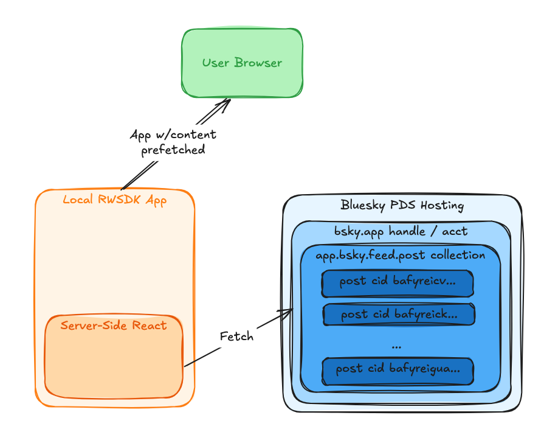

I've been nerding out on the [AT Protocol](https://atproto.com/) (aka `ATP`) recently mostly around learning what it is, how it works, and why it is awesome.  When it came time to try my hand at _building_ on the protocol, I found things a little rockier than I'd hoped.  While many aspects of the protocol are the same as any traditional web app there are some key differences and it was hard to figure out how to make the mental shift. This is the first post in a series walking through my own experience of taking a framework I'm familiar with and getting something usable built on the protocol.  I built a quick little ["table of contents"](https://arsdehnel.github.io/rwsdk-atproto-starter/) site for the project, as well, if you prefer to navigate these posts that way.

## RWSDK Starer Project

To get us started quickly we're starting from the [RWSDK `create-rwsdk` command](https://docs.rwsdk.com/getting-started/quick-start).This gets us a quick working RedwoodSDK app to build on.  I like `pnpm` for my package manager but you change change to `npm`, `yarn`, or probably `bun` throughout.

```sh
pnpx create-rwsdk rwsdk-atproto-starter
```

Once you have that done you can start up with these two commands.

```sh
pnpm install
pnpm dev
```

## First ATP Read

While many things about the ATP were mind-bending to think about perhaps the best place to start is that the data is just... public. No API key, no OAuth dance, no account required. You can make a plain `fetch` call to a URL right now and get real records back from real people. That's where I wanted to start this series — with the simplest possible thing that actually works.

## The plan for the series

As mentioned, this is Post 1 of an 8-part series building [a starter AT Protocol app](https://atproto.com/guides/statusphere-tutorial) on [RedwoodSDK](https://rwsdk.dev) and [Cloudflare Workers](https://developers.cloudflare.com/workers). Each post has a companion branch in [the starter kit repo](https://github.com/arsdehnel/rwsdk-atproto-starter). By the end we'll have a local development environment capable of OAuth login against local or real Bluesky accounts, a typed lexicon client for reading and writing records, and a basic AppView that indexes data from other users. But I'm getting ahead of myself.  None of that matters until you understand what a record even is.  The series tries to add these new terms and concepts only as they are needed to avoid overwhelming you with learning before you've built anything.  

## Initial terms

Two terms you'll need for this post with further reading links if you want to go deeper.

- **PDS (Personal Data Server):** this is where your ATP records actually live. Bluesky operates one at `bsky.social`. When you sign up for Bluesky, your posts, follows, and likes are stored as records on a PDS. The important thing here is that these records are publicly accessible over HTTP — no auth required to read them. 
    - [atproto.com definition](https://atproto.com/guides/the-at-stack#pds)

- **XRPC:** the RPC protocol ATP uses to talk to a PDS. It's just HTTP. Endpoints follow the pattern `https://<pds>/xrpc/<nsid>` where the [NSID](https://atproto.com/specs/nsid) is a reverse-domain identifier for the method, like `com.atproto.repo.listRecords`. If you've ever worked with a REST API this will feel familiar as it is just a specific implementation of the same concepts.
    - [atproto.com spec](https://atproto.com/specs/xrpc)

## The fetch

Since the data is actually truly public here is all the code we need to read some ATP records from a known PDS:

```typescript
const BSKY_ENDPOINT = "https://bsky.social/xrpc/com.atproto.repo.listRecords?repo=bsky.app&collection=app.bsky.feed.post&limit=3"
const response = await fetch(BSKY_ENDPOINT);
const data = await response.json();
```

That's it. `repo` is the account you're reading from — you can use a [handle](https://atproto.com/specs/handle) like `bsky.app` (the handle for the bluesky team themselves) or a [DID](https://atproto.com/specs/did) directly. `collection` is the type of records you want. `limit` is self-explanatory. [Open that URL in a browser](https://bsky.social/xrpc/com.atproto.repo.listRecords?repo=bsky.app&collection=app.bsky.feed.post&limit=3) and you'll see the same JSON the starter kit app is rendering.

## The response

The response comes back as a `records` array. Each entry looks like this:

```json
{
  "uri": "at://did:plc:z72i7hdynmk6r22z27h6tvur/app.bsky.feed.post/3mxp32vwd4c24",
  "cid": "bafyreihqdcbrbqnvc5wsbnnfyhh7pq73ckvuxv4532f5ustkvvqkfbvtju",
  "value": {
    "$type": "app.bsky.feed.post",
    "text": "...",
    "langs": ["en"]
  }
}
```

A few more concepts we should cover here in working through the response:

- **AT URI:** the `uri` field is the globally unique address of this record in the AT Protocol network. It breaks down as `at://<did>/<collection>/<rkey>`. The DID is the account identifier. The collection is the record type. The [**rkey** (record key)](https://atproto.com/specs/record-key) is the unique ID of this specific record within that collection — in this case `3mxp32vwd4c24`.
    - [atproto.com AT URI spec](https://atproto.com/specs/at-uri-scheme)
    - [atproto.com record key spec](https://atproto.com/specs/record-key)

- **CID:** the content identifier. This is a hash of the record's content, which means it's also a proof of integrity. If the content changes, the CID changes. You'll see CIDs used throughout AT Protocol wherever something needs to reference a specific, immutable version of a record.
    - [atproto.com glossary entry](https://atproto.com/guides/glossary#cid-content-id)
    - [atproto.com spec reference](https://atproto.com/specs/data-model#link-and-cid-formats)

- **`$type`:** every record has a `$type` field that matches the collection it lives in. `app.bsky.feed.post` is a Bluesky post. Later in the series we'll use lexicons to work with these types in a more structured way, but for now it's just a string in the JSON.
    - [atproto.com guide reference](https://atproto.com/guides/lexicon#record-types)

## The companion code

The starter kit puts the fetch directly in the page component, which runs [server-side on the Worker](https://docs.rwsdk.com/core/react-server-components).  

```typescript
export async function Home(_: RequestInfo) {
  const response = await fetch(BSKY_ENDPOINT);
  const records = await response.json();

  return <BlueskyFeed endpoint={BSKY_ENDPOINT} records={records} />;
}
```

No client-side loading state, no effect hooks so the data is in the HTML before it hits the browser. `BlueskyFeed` is a `"use client"` component that renders the JSON, which is also where its scoped CSS lives. The page itself is a server component with no style dependencies of its own. 

For more details on these React Service Components mechanics here are some docs starting points:

- [RWSDK Server Components](https://docs.rwsdk.com/core/react-server-components)
- [How RSC Works](https://www.plasmic.app/blog/how-react-server-components-work)

## Current Flow Diagram

Visuals always help.  This is roughly the flow and architecture of what we have at this point.



## Reminder: this is an initial demo

This approach is nothing you'd do for a full app in production.  The public read part is fine but hardcoding to a specific handle without error handling or anything would be ill-advised.  Later posts will address this (albeit indirectly) to get things closer to a production-ready application architecture.

## Up Next

Check out the [`post/series-1/01-get-started`](https://github.com/arsdehnel/rwsdk-atproto-starter/tree/post/series-1/01-get-started) branch to see the full code. [Post 2](./rwsdk-atp-s1-p2-atp-oauth) is where things get more interesting: AT Protocol OAuth against a real Bluesky account.
