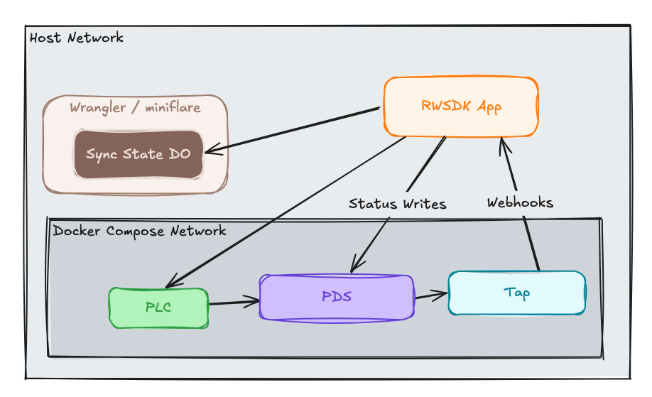

[Post 4](./rwsdk-atp-s1-p4-atp-writes) ended with the app reading a status record back from the PDS immediately after writing it. That works at small scale and for users that flow through your experience but it misses a lot of what makes AT Protocol interesting. This post walks through the final piece in our local development setup that aims to approximate the Atmosphere as closely as possible through a Cloudflare Worker lens.

## Two patterns for reads in AT Protocol

While the direct PDS read operation is a part of nearly every ATP-based application it has key gaps and limits that need to be called out.  These aren't problems with the PDS, they are just important aspects to be aware of when building for the Atmosphere. 

**Optimistic update** when you write a record and the PDS confirms it, you already have the data. Update your local store immediately from what you sent rather than waiting for anything to come back from the network. The term `optimistic update` could be confusing to user here for developers used to updating a UI before the DB has the data.  This is a slightly different aspect of the architecture we're considering to be optimistically updating but the concept is the same.  The ultimate "source of truth" in the ATP is the Relay/Firehose so we're _optimistically_ using the data we already have instead of waiting for the loop back.


This is fast (no extra round-trip, no relay delay) and correct for your own writes. Its limitation: it only covers writes that originate in your own app and data elements you already have.

**Relay / firehose** is a part of the Atmosphere we haven't talked about yet.  It is a live real-time stream of all events happening throughout the ecosystem.  This is perhaps the single most fundamentally different concept when compared to standard web application architectures.  The existence of the firehose allows other apps to subscribe to [the firehose of events](https://atproto.com/guides/streaming-data) and do with them what they will.  For our case we want to pull status updates into our view that might not have been created through our user experience.  


This diagram oversimplifies it but for our local demo it's accurate.  A user can produce a Lexcion-compliant record however they choose, and the publication of that data from the PDS happens automatically.  Our app is subscribed to those events so even though our app didn't produce the record we receive it and can use it in our queries and user experience components. 

Since our own writes flow through this same flow we could just use it for all updates but those writes would feel slow. Using only optimistic updates misses everything that happens outside your app. For this post we're trying to keep this as simple as possible (admittedly it is still a fair amount of code) and pushing record updates into our experience as they flow in.  

## The relay side: Tap

In a fully built [AppView](https://atproto.com/guides/the-at-stack#app-views), you would subscribe to [the firehose](https://atproto.com/guides/streaming-data), index the records you care about, and serve reads against that index. [Tap](https://atproto.com/guides/the-at-stack#tap) is a lightweight component that handles the firehose subscription and delivers matching events to your app as HTTP webhooks.  For local development we can skip the actual relay and firehose but still build our application to be reasonably ready for that architecture when it hits production.  For more on getting this app and the Tap/Relay mechanics ready for production checkout [the second series I've put together](./rwsdk-atp-s2-p1-production-oauth).

## Adding Tap to Docker Compose

This is more code I pulled from [OpenMeet-Team's atproto-devnet](https://github.com/OpenMeet-Team/atproto-devnet) repo which has now become Snowglobe.  Since that repo has changed names they've removed the compose references. 

```yaml
tap:
  image: ghcr.io/bluesky-social/indigo/tap:latest
  restart: unless-stopped
  depends_on:
    pds:
      condition: service_healthy
  environment:
    TAP_RELAY_URL: http://pds:3000
    TAP_PLC_URL: http://plc:2582
    TAP_DATABASE_URL: sqlite:///data/tap.db
    TAP_DISABLE_ACKS: "true"
    TAP_WEBHOOK_URL: ${TAP_WEBHOOK_URL:-http://host.docker.internal:5173/webhooks/tap}
    TAP_COLLECTION_FILTERS: xyz.statusphere.status
    TAP_LOG_LEVEL: info
  extra_hosts:
    - "localhost:host-gateway"
    - "host.docker.internal:host-gateway"
  volumes:
    - tap-data:/data
  ports:
    - "2480:2480"
  networks:
    - atproto-devnet
  healthcheck:
    test: ["CMD", "wget", "-q", "--spider", "http://127.0.0.1:2480/health"]
    interval: 60s
    timeout: 5s
    retries: 5
```

A few things worth explaining:

- **`TAP_WEBHOOK_URL`:** instead of the WebSocket channel mode (where your app connects to Tap), this puts Tap in webhook mode: it POSTs events to your app's URL. That's the right model for a Cloudflare Worker, which handles incoming requests rather than maintaining persistent outgoing connections. The default points at `host.docker.internal:5173`, which resolves to the host machine from inside the container — see `extra_hosts` below for how that's wired up.

- **`TAP_COLLECTION_FILTERS`:** Tap only delivers events for this collection. Everything else on the firehose is silently and conveniently dropped before the webhook fires.  Given that this is a local network for events it probably isn't necessary but it's a good pattern to establish regardless.

- **`extra_hosts`:** two entries, both using Docker's `host-gateway` special value which resolves to the host machine's IP regardless of platform (macOS, Linux, Windows). The first — `localhost:host-gateway` — is needed because the PDS registers itself as `http://localhost:3000` (that's what `PDS_HOSTNAME: localhost` does, and it's what makes OAuth work from your browser). When Tap later resolves a user's DID document, it finds `localhost:3000`. Inside the container `localhost` means the container itself, not the host — so without this mapping every repo resync attempt fails with connection refused. The second — `host.docker.internal:host-gateway` — makes the `TAP_WEBHOOK_URL` default work everywhere: Docker Desktop provides `host.docker.internal` automatically on macOS and Windows, but on Linux with Docker Engine you need the explicit mapping.

- **`TAP_DISABLE_ACKS: "true"`:** in development, fire-and-forget delivery is fine. Acks are for production reliability.

- **`TAP_SIGNAL_COLLECTION`** the [Statusphere tutorial](https://atproto.com/guides/statusphere-tutorial) uses `--signal-collection` to tell Tap to automatically discover any repo on the network that has records in a given collection. That's a useful production feature for indexing the full network but it doesn't work against our local setup. The discovery mechanism calls the `listReposByCollection` xrpc endpoint on the PDS but that's not really a PDS endpoint so the PDS we're using proxies that off to a Relay... or at least it tries to.  It checks for authentication first which is what results in the 401 but even if we provided auth to get through that check the upstream call to a Relay would fail because we don't have a Relay running.  Even if we did add the auth _and_ the Relay I think the "register PDSs on user login" for this demo and starter kit is cleaner and easier to understand.  Given that this is not part of the AppView that you'll be deploying at the end of all of this it's not a production worry, either. 

- **Vite Networking in Docker:** Tap's webhook POST arrives at the Vite dev server with `Host: host.docker.internal:5173`. Vite only responds to `localhost` and `*.localhost` domains [by default](https://vite.dev/config/server-options#server-allowedhosts). Adding the docker host to the `allowedHosts` lets requests through to the worker dev server, the fix is one line in `vite.config.mts`:

    ```typescript
    server: {
      host: "127.0.0.1",
      allowedHosts: ["host.docker.internal"], // <-- this one is the new line to add
    },
    ```

## Registering repos with Tap

Since we can't use `TAP_SIGNAL_COLLECTION` locally, Tap only watches repos it's been explicitly told about.  The most logical time to register a user's repo is right after they log in and for local development that works just fine.  In preparing for production we'll solve this in a different way.

```typescript
// src/app/api/oauth-callback.ts
export async function get({ request, response }: RequestInfo) {
  const client = await getOAuthClient();
  const { session } = await client.callback(new URL(request.url).searchParams);

  await sessionStore.save(response.headers, { did: session.did });

  try {
    await fetch(`${env.ATPROTO_TAP_URL}/repos/add`, {
      method: "POST",
      headers: { "Content-Type": "application/json" },
      body: JSON.stringify({ dids: [session.did] }),
    });
  } catch {
    // Tap may not be running. Non-fatal: the feed just won't update live.
  }

  response.headers.set("Location", "/");
  return new Response(null, { status: 302, headers: response.headers });
}
```

`ATPROTO_TAP_URL: "http://localhost:2480"` goes in `wrangler.jsonc`. The call is wrapped in try/catch because if you decided to deploy this to a place it'll hit live PDSs this call won't work but the rest of your app could run and be demoable.  We'll remove this call entirely in the [deploy prep](./rwsdk-atp-s2-p4-deploy-prep) post.

## The webhook endpoint

The [`@atproto/tap`](https://github.com/bluesky-social/atproto/blob/main/packages/tap/README.md) npm package ships a `parseTapEvent` helper that validates and parses the JSON body Tap POSTs:

```typescript
import { parseTapEvent } from "@atproto/tap";
import type { LexValue } from "@atproto/lex";

export async function post({ request }: RequestInfo): Promise<Response> {
  const body = await request.json();
  const event = parseTapEvent(body as LexValue);

  if (event.type !== "record" || event.collection !== "xyz.statusphere.status") {
    return new Response("ok");
  }

  if (event.action === "delete") {
    statusStore.delete(event.did);
  } else {
    const handle = await resolveHandle(event.did);
    statusStore.set(event.did, {
      did: event.did,
      handle,
      status: event.record?.status as string,
      updatedAt: new Date().toISOString(),
    });
  }

  pushToSseClients(Array.from(statusStore.values()));
  return new Response("ok");
}
```

`parseTapEvent` covers two event types: `record` (create, update, delete for a specific record) and `identity` (handle changes, account status). We only care about `record` events for our collection. The handle resolution is a best-effort `describeRepo` call to the PDS (the DID is guaranteed, the handle is display metadata).

## Pushing updates with `useSyncedState`

The webhook receives events from Tap but how do those events reach the browser in real time? Originally I tried using a server-sent events pattern but that required managing a set of open response streams in memory which started to get ugly fast. RWSDK ships a higher-level primitive that handles all of that by leveraging websockets: [`useSyncedState`](https://docs.rwsdk.com/experimental/realtime).

The model has two pieces: a server-side [Durable Object](https://developers.cloudflare.com/durable-objects/) that holds the shared state and pushes updates to connected clients, and a client-side React hook that subscribes to it.

### The Durable Object

`SyncedStateServer` (from `rwsdk/use-synced-state/worker`) is a base class for Durable Objects that know how to broadcast state changes to all connected clients over a WebSocket:

```typescript
// src/app/durable-objects/appview-sync-state.ts
import { SyncedStateServer } from "rwsdk/use-synced-state/worker";

export type StatusEntry = {
  did: string;
  handle: string | null;
  status: string;
  updatedAt: string;
};

export class AppViewSyncState extends SyncedStateServer {
  updateStatus(did: string, status: string, handle: string | null) {
    const current = (this.getState("statusMap") ?? {}) as Record<
      string,
      StatusEntry
    >;
    current[did] = { did, handle, status, updatedAt: new Date().toISOString() };
    this.setState(current, "statusMap");
  }

  removeStatus(did: string) {
    const current = (this.getState("statusMap") ?? {}) as Record<
      string,
      StatusEntry
    >;
    delete current[did];
    this.setState(current, "statusMap");
  }
}
```

You call `getState("statusMap")` to read the current value for a named key and `setState(value, "statusMap")` to write it. Writing automatically pushes the new state to every client that has an open WebSocket connection to this DO instance. Like any DO class in a Worker it needs to be exported from `worker.tsx` (so Cloudflare can find the code for it), and bound in `wrangler.jsonc` (so Cloudflare can register it properly at deploy time):

```typescript
// src/worker.tsx
export { AppViewSyncState } from "@/app/durable-objects";
```

```jsonc
// wrangler.jsonc
"durable_objects": {
  "bindings": [
    { "name": "DO_APPVIEW_SYNC_STATE", "class_name": "AppViewSyncState" }
  ]
},
"exports": {
  "AppViewSyncState": { "type": "durable-object", "storage": "sqlite" }
}
```

### Calling into the DO from the webhook

Once those are in place we can have the webhook API handler talk directly to the DO stub to get those updates out to the connected clients.  We start by getting the DO "stub" by using the [`getByName()`](https://developers.cloudflare.com/durable-objects/api/namespace/#getbyname) method.  The name here defaults to [`syncedState`](https://github.com/redwoodjs/sdk/blob/c22107307e18657bc03b3c1b6a160584e5c7f56b/sdk/src/use-synced-state/worker.mts#L19) but we give it a better and more clear name in our worker registration (the next section talks about that specific code change):

```typescript
// src/app/api/webhooks-tap.ts (updated)
if (event.action === "delete") {
  const stub = env.DO_APPVIEW_SYNC_STATE.getByName("appViewSyncState");
  await stub.removeStatus(event.did);
} else {
  const status = (event.record?.status as string) ?? "";

  let handle: string | null = null;
  try {
    const res = await fetch(
      `${env.ATPROTO_PDS_URL}/xrpc/com.atproto.repo.describeRepo?repo=${event.did}`,
    );
    const data = (await res.json()) as { handle?: string };
    handle = data.handle ?? null;
  } catch {
    // Handle resolution is best-effort.
  }

  const stub = env.DO_APPVIEW_SYNC_STATE.getByName("appViewSyncState");
  await stub.updateStatus(event.did, status, handle);
}
```

In here the `getByName("appViewSyncState")` pulls up the specific DO instance in use by the `useSyncedState` hook.  This gives us access to the storage behind it and can update it directly and allow the RWSDK code to push that out to connected clients.

### Wiring up the routes

In order for the websocket communication to really work the `syncedStateRoutes` from RWSDK needs to register the WebSocket upgrade route that clients connect to. It goes into the middleware chain in `worker.tsx` before the page routes.  This is also where we provide the custom name for the DO instance.

```typescript
// src/worker.tsx
import { syncedStateRoutes } from "rwsdk/use-synced-state/worker";

export default defineApp([
  setCommonHeaders(),
  async ({ ctx, request }) => {
    ctx.session = await sessionStore.load(request);
  },
  ...syncedStateRoutes(() => env.DO_APPVIEW_SYNC_STATE, {
    durableObjectName: "appViewSyncState",
  }),
  // ... rest of routes
]);
```

### The client component

On the client, `useSyncedState` returns the current value of a named state key and re-renders whenever the DO pushes an update. The hook manages the WebSocket connection lifecycle automatically:

```typescript
// src/app/components/status-board/status-board.tsx
"use client";
import { useSyncedState } from "rwsdk/use-synced-state/client";
import type { StatusEntry } from "@/app/durable-objects";

export function StatusBoard() {
  const [statusMap] = useSyncedState<Record<string, StatusEntry>>(
    {},
    "statusMap",
  );

  // ...render the status list from statusMap
}
```

The first argument to `useSyncedState` is the initial value used before the WebSocket connects. The second is the state key name matching the one used in `getState`/`setState` on the DO.

The component file starts with `"use client"` because it contains browser-specific behavior (a WebSocket connection and React state). The server renders the shell; the client hydrates it and opens the connection.

## External data

With all of that setup we can create some data outside of our application (in our case just through a simple script) and that'll flow through Tap and our DO which will push it up to our user experience. The `scripts/write-status.ts` script added in this post isn't really a very likely production pattern but it does the job of illustrating how data could be created for our Lexicon in other ways. 

The breakdown of the script is simple:
1. Authenticates as Carol to our local docker-hosted PDS
2. Register's her PDS with our local Tap
3. Publishes her status to her PDS

In production Step 2 wouldn't be necessary as a Relay would handle that discovery for us.  But locally it works for us and get us the key outcome: the webhook comes through from Tap to our application and the data shows in our UI.  For us locally this proves our app is aware of this common ATP pattern even if this specific "use a script" pattern isn't the likely way Carol would manage her status. 

## The companion code

The [`post/series-1/05-tap-sync`](https://github.com/arsdehnel/rwsdk-atproto-starter/tree/post/series-1/05-tap-sync) branch includes all the code mentioned here and is ready to run. The diff between last step and this one can be seen in [this PR](https://github.com/arsdehnel/rwsdk-atproto-starter/pull/75).

## Current architecture diagram

To help keep our mental model up-to-date here is a little diagram of our current application architecture now including the Tap flow.



## What's next

This wraps up our local development setup!  From here you can keep doing local development things as you want and when you're ready dive into Series 2 starting with [post 1 about productionizing OAuth](./rwsdk-atp-s2-p1-production-oauth).