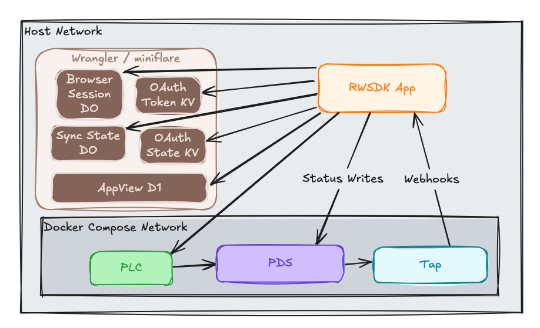

After [Post 1 of this series](./rwsdk-atp-s2-p1-production-oauth) made OAuth production-ready, the app's data layer is still just the Durable Object in-memory state map. That's fine for pushing live updates to connected clients, but it's not a queryable store and it doesn't survive DO eviction. And as we build a more fully-featured application it is not the right place to answer questions like "what are the most popular statuses across all users?"

This post adds [Cloudflare D1](https://developers.cloudflare.com/d1/) as a relational store and wires into the Tap webhook handler so every incoming status record gets persisted. [Drizzle ORM](https://orm.drizzle.team) handles schema definition and queries.

## Why D1 alongside the Durable Object

The Durable Object stays — it's still useful for real-time pushes to connected WebSocket clients. But it's an eventually-consistent in-memory store that can be evicted. D1 is the durable record of what's happened: every status event that came through the firehose, keyed in a way that supports aggregation queries.

The two layers serve different purposes. The DO handles the real-time push of a specific user experience element.  D1 enables things like querying "what are the top statuses across all users?" in addition to providing a more resilient data source for bootstrapping the DO should it be evicted or corrupted.

## Schema

Aiming to keep this simple we're just doing two small tables: `users` and `statuses`, with a foreign key relationship. This allows us the capture of statuses with the additional benefit of FKs and indexes for features we will undoubtedly build.

```typescript
// src/db/schema.ts
export const users = sqliteTable("users", {
  did: text().primaryKey(),
  handle: text(),
  createdAt: text().notNull().default(sql`(datetime('now'))`),
  updatedAt: text().notNull().default(sql`(datetime('now'))`),
});

export const statuses = sqliteTable("statuses", {
  id: integer().primaryKey({ autoIncrement: true }),
  did: text().notNull().references(() => users.did, { onDelete: "cascade" }),
  status: text().notNull(),
  rev: text(),
  atUri: text().notNull().unique(),
  receivedAt: text().notNull(),
});
```

A few things worth noting here:

1. **`atUri` is the idempotency key:** each AT Protocol record has a unique AT URI (`at://did/collection/rkey`). Using it as a unique constraint means the webhook handler can safely call `INSERT ... ON CONFLICT DO UPDATE` — if the same event is delivered twice, the second write is a no-op (or a safe update if the record changed).

2. **`rev` enables ordering:** AT Protocol record keys (TIDs) are lexicographically sortable by time, so string comparison is a correct way to check if one version is newer than another. The upsert uses this:

```typescript
// Only overwrite if the incoming rev is newer than what's stored.
// TIDs are lexicographically sortable by time, so string comparison is correct.
setWhere: sql`excluded.rev > COALESCE(${statuses.rev}, '')`,
```

**`users` is its own table.** The same DID can appear across many status records, and we want to track the handle separately. The `upsertUser` function is called from both the OAuth callback (DID only, handle unknown at that point) and the Tap webhook (DID + resolved handle). The conflict resolution preserves the existing handle if the incoming value is null since webhook events can arrive before handle resolution succeeds.

## The database module

Nothing fancy here but just standard Drizzle leveraging the `snake_case` casing so we get `camelCase` typescript imports but `snake_case` table and index names.

```typescript
// src/db/db.ts
export const db = drizzle(env.DB, { schema, casing: "snake_case" });
```

One thing worth noting for anyone coming from plain SQLite: in vanilla SQLite, foreign key enforcement is disabled by default and requires `PRAGMA foreign_keys = ON` per connection. D1 is different as [D1 enforces FK constraints by default](https://developers.cloudflare.com/d1/sql-api/foreign-keys/) on every query, so there's nothing to configure.

## Wiring the webhook

The Tap webhook handler gets two new calls per event: upsert the user record, then upsert the status. On a delete event, remove the status by AT URI.

```typescript
// src/app/api/webhooks-tap.ts (relevant additions)
const atUri = `at://${event.did}/${event.collection}/${event.rkey}`;

if (event.action === "delete") {
  await deleteStatus(atUri);
  const stub = env.DO_APPVIEW_SYNC_STATE.getByName("appViewSyncState");
  await stub.removeStatus(event.did);
} else {
  const handle = // ... handle resolution
  await upsertUser(event.did, handle);
  await upsertStatus(event.did, atUri, status, event.rev);
  const stub = env.DO_APPVIEW_SYNC_STATE.getByName("appViewSyncState");
  await stub.updateStatus(event.did, status, handle);
}
```

## Webhook security

Tap sends its admin password as HTTP Basic auth on every outgoing webhook POST — the same credential used for its own API. The `WEBHOOK_TAP_SECRET` secret must match `TAP_ADMIN_PASSWORD` in docker-compose, and the check is unconditional:

```typescript
const expected = `Basic ${btoa(`admin:${env.WEBHOOK_TAP_SECRET}`)}`;
const actual = request.headers.get("Authorization") ?? "";
if (actual !== expected) {
  return new Response("Unauthorized", { status: 401 });
}
```

This will fail loudly when the secret is not provided and that's intentional.  Making this conditional on the secret being present would be a footgun: a production deployment that forgets to configure the secret would silently skip auth entirely instead of failing. Since `WEBHOOK_TAP_SECRET` is in `wrangler.jsonc`'s `secrets.required` array and Tap always sends the header locally, there's no reason to make the check optional.

## Tap repo-registration vs signal collection

In Series 1, registering a user's repo with the local Tap happened in the OAuth callback.  When a user logs in we make an explicit call to our Tap container to register the DID, and webhook events started flowing. That was convenient but it tied Tap registration to the OAuth flow, which isn't generally a good or necessary practice in production.

In production you can use Tap [`Signal Collection`](https://atproto.com/blog/introducing-tap#network-boundaries-and-filtering) to receive any records of a particular Lexicon rather than requiring individual DID/PDS registrations.  This scales much more seamlessly and avoids your application having to manage all the connections and subscriptions.

### Moving registration

While it seems like we could possibly just run `relay` in our local network to enable a path towards `signal collection` the Docker image for that repo doesn't have a way to disable SSRF even locally.  So we're left to figure out another way.  To avoid the application code introduced in Series 1 that does the per-PDS registration this post moves that registration to our initialization script. 

```sh
# scripts/init.sh (excerpt)
DIDS=$(grep '_DID=' "${DATA_DIR}/accounts.env" | sed 's/.*_DID=//' | tr '\n' ',' | sed 's/,$//')
if [ -n "$DIDS" ]; then
  JSON_ARRAY=$(...)
  curl -sf -X POST "${TAP_URL}/repos/add" \
    -H "Content-Type: application/json" \
    -H "Authorization: Basic $(printf 'admin:%s' "${TAP_ADMIN_PASSWORD}" | base64)" \
    -d "{\"dids\": ${JSON_ARRAY}}"
fi
```

This effectively does the same thing but it importantly takes the logic and code out of our production app code. The OAuth callback no longer makes any Tap API calls. This is cleaner separation: local dev tooling lives in local dev scripts; the application code doesn't know about Tap registration.

## Local D1 setup

D1 local development runs through Wrangler's embedded SQLite, no `wrangler d1 create` needed. The binding uses `"database_id": "local"` as a placeholder.

```jsonc
// wrangler.jsonc
"d1_databases": [
  {
    "binding": "DB",
    "database_name": "rwsdk-atproto-starter",
    "database_id": "local",
    "migrations_dir": "drizzle"
  }
]
```

Drizzle generates migration files under `drizzle/` from the schema. Run `pnpm migrate:dev` (which maps to `wrangler d1 migrations apply DB --local`) to apply them against the local SQLite database before starting the dev server.  If you forget to run this migration command you'll get some gnarly Drizzle/SQLite errors in the Workers logs (I know from experience) that aren't particularly clear on what's going on. 

## The companion code

The [`post/series-2/02-d1-persistence`](https://github.com/arsdehnel/rwsdk-atproto-starter/tree/post/series-2/02-d1-persistence) branch has all of this in place. The diff from the previous post is in [this PR](https://github.com/arsdehnel/rwsdk-atproto-starter/pull/101).

## Current architecture diagram

D1 is now part of the write path for every incoming Tap webhook event.



## Up Next

With records in D1, [Post 3](./rwsdk-atp-s2-p3-appview-features) builds AppView-style features on top of them: aggregate queries, improved handle resolution, and bootstrapping the Durable Object from D1 on cold start.
