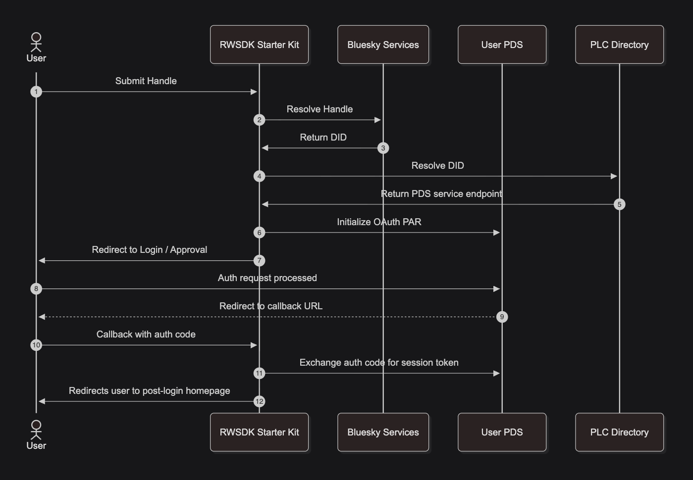

[Post 1](./rwsdk-atproto-01-first-read) showed that [AT Protocol](https://atproto.com/) data is publicly readable with a plain fetch. That's a neat little initial hook but doesn't get you very far if you're looking to build an actual app for the [Atmosphere](https://atproto.com/guides/glossary#atmosphere). To write records, read private data, or act on behalf of a user, you need OAuth. This is Post 2 of 8, and it's where the more interesting problem solving and development effort starts.

AT Protocol uses OAuth 2.1 under the hood, not just standard OAuth 2.0 stuff. The pairing of the less trodden paths of that with RWSDK results in a handful of rough edges due to it running inside [Cloudflare's `workerd` runtime](https://github.com/cloudflare/workerd) instead of Node.js. This post documents those edges and the decisions behind how I chose to work around them.  

## The flow

At a high level the exchange looks like this showing that OAuth 2.1 [Auth Code Flow with PAR](https://auth0.com/docs/get-started/authentication-and-authorization-flow/authorization-code-flow/authorization-code-flow-with-par) since [AT Proto requires PAR support for PDSs](https://atproto.com/specs/oauth).

1. User submits their ATP handle. The Worker resolves it to a PDS, initiates a Pushed Authorization Request (PAR), and returns a redirect URL.
2. The browser redirects to the authorization page indicated by the PDS (such as `bsky.social`).
3. User logs in and/or approves. The auth server  (`bsky.social` or other) redirects back to your callback URL with an authorization code.
4. The Worker exchanges the code for a session, saves the user's DID, and redirects home.

The Worker never sees the user's password. It ends up with an OAuth session it can use to make authenticated requests on behalf of the user.

## Before OAuth: session storage

Even though we're just working locally in this series we need a session implementation to help connect browser sessions to server-side storage and processing pieces.  In production, Cloudflare Workers don't share memory across [isolates](https://developers.cloudflare.com/workers/reference/how-workers-works/#isolates). For now since we're working locally only we're going to just use an in-memory store that leverages `globalThis` to define in-memory storage that survives the worker restarts during development.  This still isn't production ready but that's not our concern right now.

```typescript
export const sessionStore = {
	async load(request: Request) {
		const id = getSessionId(request);
		if (!id) return null;
		return sessions.get(id) ?? null;
	},
	async save(headers: Headers, data: { did: string }) {
		const id = crypto.randomUUID();
		sessions.set(id, data);
		headers.append("Set-Cookie", `sid=${id}; Path=/; HttpOnly; SameSite=Lax`);
	},
	async remove(request: Request, headers: Headers) {
		const id = getSessionId(request);
		if (id) sessions.delete(id);
		headers.append("Set-Cookie", "sid=; Path=/; HttpOnly; Max-Age=0");
	},
};
```

And then we leverage the RWSDK middleware pipeline to load the session data on each request:

```typescript
export default defineApp([
  ...other middleware...
	async ({ ctx, request }) => {
		ctx.session = await sessionStore.load(request);
	},
  ...other middleware and pages...
]);
```

## The OAuth client

With sessions sorted we can move on to the OAuth client which we're pulling from [`@atproto/oauth-client-node`](https://www.npmjs.com/package/@atproto/oauth-client-node). Two options matter for `workerd`:

- **`handleResolver` as a string URL:** If you know anything about the package it might seem like `AtprotoHandleResolverNode` is the better option, but it wraps every fetch with `safeFetchWrap`, which pulls in Node.js's `undici`. And `undici` isn't available in `workerd`. Passing a plain string URL instead makes the client use a different resolver that calls `globalThis.fetch` which is available everywhere.

- **`buildAtprotoLoopbackClientMetadata`:** This sets `client_id` to `http://localhost/`, a special value [that `bsky.social` and all AT Proto PDSs recognize for local development](https://atproto.com/specs/oauth#clients). No app registration, no hosted metadata endpoint required.

```typescript
const client = new NodeOAuthClient({
  handleResolver: "https://bsky.social",
  clientMetadata: buildAtprotoLoopbackClientMetadata({
    scope: "atproto",
    redirect_uris: ["http://127.0.0.1:5173/oauth/callback"],
  }),
  stateStore: { /* in-memory Map on globalThis */ },
  sessionStore: { /* in-memory Map on globalThis */ },
});
```

The `stateStore` and `sessionStore` on the client are setup using `globalThis` just like our browser sessions we setup above. The browser session answers "which user is this request from?" — it stores `{ did }` and is keyed by a signed session ID cookie. The OAuth client's stores answer "what authenticated access do we have for this DID?" — they hold the actual tokens and [DPoP](https://atproto.com/specs/oauth#demonstrating-proof-of-possession-d-po-p) key material, keyed by [DID](https://atproto.com/specs/did). The OAuth package's use of "session" here can be a little confusing in the delineation between these things.

As mentioned for this post both client stores are in-memory Maps on `globalThis`. That means state and tokens survive the local file-save restarts but are lost if the production Worker restarts or you get a different isolate handling the requests. It doesn't matter yet because we only fetch public records here, but it's one of the first things we'll solve in [Series 2's first post](./rwsdk-atp-s2-p1-production-oauth). At that point the OAuth token store will need its own durable backing, keyed by DID.

One detail: use `http://127.0.0.1:5173`, not `http://localhost:5173`. After approving access, the authorization server redirects to the exact redirect URI you registered. If the app is open at `localhost`, the callback lands on a different origin and the session won't be established. Not only that but [using 127.0.0.1 follows AT Proto expected behavior](https://atproto.com/specs/oauth#localhost-client-development).

## Workerd-specific gotchas

### `redirect: "error"` rejection

Cloudflare Workers rejects `redirect: "error"` in fetch options — [the workerd source throws a `TypeError` at Request construction time](https://github.com/cloudflare/workerd/blob/01bb2e6deca73934885507d25ba105a0dfe202e6/src/workerd/api/http.c%2B%2B#L483). The `@atproto` packages use this option pervasively as an SSRF guard: they explicitly don't want to follow redirects on DID/handle lookups and OAuth metadata fetches, since those URLs come from user input.

The fix is a Vite plugin that rewrites all occurrences at build time, replacing `"error"` with `"manual"`:

```typescript
function patchAtprotoRedirectError(): Plugin {
  return {
    name: "patch-atproto-redirect-error",
    transform(code: string, id: string) {
      if (id.includes("@atproto") || id.includes("atproto-labs")) {
        return code.replace(/redirect:\s*['"]error['"]/g, "redirect: 'manual'");
      }
    },
  };
}
```

`"manual"` is [supported by workerd](https://developers.cloudflare.com/workers/runtime-apis/request/) and keeps the closest semantics to `"error"`: instead of throwing, it returns the `3xx` response to the caller as-is. Because all of the affected atproto call sites check `response.ok` immediately after the fetch, an unexpected redirect surfaces as a non-ok response and fails — preserving the intended guard. Using `"follow"` would also silence the `TypeError` but would silently drop that guard by automatically following unexpected redirects.

This goes first in the Vite plugin list, before the Cloudflare and RedwoodSDK plugins.

## The companion code

The starter kit changes are too numerous to list here but [this PR](https://github.com/arsdehnel/rwsdk-atproto-starter/pull/98) shows the changes from Post 1 to Post 2.  To skip that the [post/series-1/02-atp-oauth](https://github.com/arsdehnel/rwsdk-atproto-starter/tree/post/series-1/02-atp-oauth) branch has the completed OAuth2 implementation: the session store, the OAuth client setup, four route handlers (`/oauth/login`, `/oauth/callback`, `/oauth/logout`, `/client-metadata.json`), and the session middleware in `worker.tsx`. 

## Current flow diagram

This attempts to show what we've got now.  The actual PDS fetch of Bluesky posts has been simplified as the diagram of that was covered in [the last post](./rwsdk-atp-s1-p1-get-started).  This post also glosses over the behind the scenes OAuth details as [Auth0 covers that better than I would](https://auth0.com/docs/get-started/authentication-and-authorization-flow/authorization-code-flow/authorization-code-flow-with-par).  

One thing that we didn't really cover in the other parts of this post is that the PDS no longer has to be on Bluesky's hosting. This setup should work against any spec-compliant AT Proto PDS for both the auth flow and the posts lookup.  The one possible variation would be if the `localhost` special treatment is carried through to the PDS but that would be something to know about for debugging possible issues in using a non-Bluesky PDS during development.



## Up Next

Check out the [`post/series-1/02-atp-oauth`](https://github.com/arsdehnel/rwsdk-atproto-starter/tree/post/series-1/02-atp-oauth) branch to see the full code and [the Post 2 Additions PR](https://github.com/arsdehnel/rwsdk-atproto-starter/pull/98) for what all we changed here. [Post 3](./rwsdk-atp-s1-p3-local-dev) begins the process of moving us from developing locally but hitting production to developing locally and having our own local Atmosphere we're hitting.
