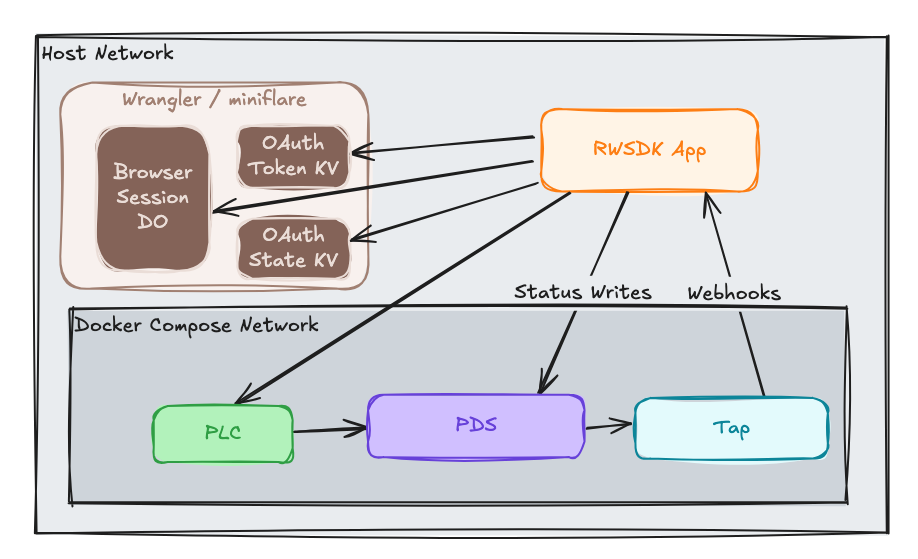

Series 1 ended with a fully working local development setup: OAuth, ATP reads/writes, and real-time updates all wired together, all running against a local PDS and PLC. But the OAuth setup had several local-only limitations:
- we used a loopback client: a special case that only works when the redirect URI is `localhost`
- we used `globalThis` for browser sessions, OAuth state, and OAuth tokens all of which won't scale to multiple Worker isolates
- none of the stored data was being encrypted and could be read easily by anyone with access to the storage mechanism

This post enhances and/or swaps all of those out for production-ready versions:
- proper confidential client
- moves OAuth state into short-lived, auto-expiring, and encrypted Cloudflare KV
- moves OAuth tokens into a Durable Object-managed storage system that handles both rotation and encryption
- moves browser sessions into a separate Durable Object-managed storage system that is accessible across isolates

## Productionizing OAuth Client

### The loopback client's limitation

The [loopback client](https://atproto.com/specs/oauth#loopback-client-metadata) is a well-known special case in the AT Protocol OAuth spec. It bypasses the normal requirement for a publicly-accessible `client_id` URL because the redirect goes to `127.0.0.1`. That made it perfect for local development — but an AT Protocol PDS will reject it the moment your redirect URI isn't a loopback address.

For production, AT Protocol uses a [discoverable confidential client](https://atproto.com/specs/oauth#clients): the `client_id` is the URL of your `client-metadata.json` document, and the PDS fetches that document to verify your identity before issuing tokens. This is what the `APP_URL` environment variable controls.

### Switching between local dev and production

The `getOAuthClient()` function conditionally builds the client metadata based on whether `APP_URL` is set:

```typescript
// src/app/lib/auth-client.ts
clientMetadata: appUrl
  ? {
      client_id: `${appUrl}/client-metadata.json`,
      scope: SCOPE,
      redirect_uris: [`${appUrl}/oauth/callback`],
      response_types: ["code"],
      grant_types: ["authorization_code", "refresh_token"],
      token_endpoint_auth_method: "none",
      application_type: "web",
      dpop_bound_access_tokens: true,
    }
  : buildAtprotoLoopbackClientMetadata({
      scope: SCOPE,
      redirect_uris: ["http://127.0.0.1:5173/oauth/callback"],
    }),
```

In the local dev stack, `APP_URL` isn't set, so the loopback client is used exactly as before. In a deployed environment, `APP_URL` is set in `wrangler.jsonc` per environment, and the discoverable client takes over. The `client-metadata.json` route was already in place from Series 1 — it just matters more now that a real PDS will actually fetch it.

## Productionizing OAuth State

### Encrypting OAuth state in KV

In Series 1, the `stateStore` (the short-lived OAuth handshake data) lived in a `globalThis` Map. That was fine locally — the state only needs to survive the seconds between the login redirect and the callback. But in production, a Worker can be invoked on different isolates for the two requests, and there's no shared memory between them. [KV](https://developers.cloudflare.com/kv/) is a solid solution here as not only does it solve cross-worker sharing but it offers auto-expiration via TTL and has a simple key-value API.

The state values are encrypted at rest using [AES-256-GCM](https://developer.mozilla.org/en-US/docs/Web/API/SubtleCrypto/encrypt) via the Web Crypto API, which is available natively in the `workerd` runtime no crypto library dependency needed.

```typescript
// src/app/lib/crypto.ts (simplified)
export async function kvEncrypt(plaintext: string, secret: string): Promise<string> {
  const key = await deriveKey(secret);
  const iv = crypto.getRandomValues(new Uint8Array(12));
  const ciphertext = await crypto.subtle.encrypt(
    { name: "AES-GCM", iv },
    key,
    new TextEncoder().encode(plaintext),
  );
  // Store as base64(iv + ciphertext) so the IV travels with the value
  const combined = new Uint8Array(iv.byteLength + ciphertext.byteLength);
  combined.set(iv);
  combined.set(new Uint8Array(ciphertext), iv.byteLength);
  return btoa(String.fromCharCode(...combined));
}
```

The key is derived from the `OAUTH_STATE_KV_ENCRYPTION_KEYS` secret using HKDF-SHA-256, which is tolerant of arbitrary string inputs (unlike raw AES key material). The secret is a JSON array to support key rotation with the first key being used to encrypt new values, all keys are tried in order on decrypt.

Storing into KV also gives us a natural TTL:

```typescript
stateStore: {
  async set(key: string, value: NodeSavedState): Promise<void> {
    const keys = parseKeyRing(env.OAUTH_STATE_KV_ENCRYPTION_KEYS);
    const encrypted = await kvEncrypt(JSON.stringify(value), keys[0]);
    await env.KV_OAUTH_STATE.put(key, encrypted, { expirationTtl: 600 }); // 10 minutes
  },
  // ...
}
```

Ten minutes is generous for a login flow. Stale entries expire automatically rather than accumulating.

## Productionizing OAuth Tokens (aka OAuth Sessions)

### Moving to a Durable Object

In Series 1, OAuth sessions (the long-lived tokens) were stored as plain JSON in KV. That created two problems for production:

1. **KV propagation lag:** KV has eventual consistency meaning a write in one region may not be immediately visible from another. For OAuth tokens that get refreshed and need to be read back quickly this could be a real problem that would be gnarly to debug and nail down.
2. **Token rotation races:** if two concurrent requests both try to refresh the same token, they can trample each other. The AT Protocol client library needs a lock primitive to serialize this.

A Durable Object solves both. It's a single instance with transactional writes and in-memory state. The `OAuthToken` DO stores one session per DID, encrypted, and provides an explicit lock:

```typescript
// src/app/durable-objects/oauth-token.ts (excerpt)
export class OAuthToken extends DurableObject {
  async acquireLock(): Promise<void> {
    // Force-release stale locks held for more than 30 seconds
    if (this.lockAcquiredAtTimestamp && Date.now() - this.lockAcquiredAtTimestamp > 30_000) {
      this.locked = false;
    }
    if (this.locked) {
      await new Promise<void>((resolve) => this.lockQueue.push(resolve));
      return;
    }
    this.locked = true;
    this.lockAcquiredAtTimestamp = Date.now();
  }

  async releaseLock(): Promise<void> {
    const next = this.lockQueue.shift();
    if (next) {
      this.lockAcquiredAtTimestamp = Date.now();
      next(); // transfer ownership to the next waiter
    } else {
      this.locked = false;
      this.lockAcquiredAtTimestamp = undefined;
    }
  }
}
```

The `requestLock` option in the OAuth client is what wires this up:

```typescript
requestLock: async (did, fn) => {
  const doStub = await env.DO_OAUTH_TOKEN.getByName(did);
  await doStub.acquireLock();
  try {
    return await fn();
  } finally {
    await doStub.releaseLock();
  }
},
```

Each [`DID`](https://atproto.com/specs/did) gets its own [`DO`](https://developers.cloudflare.com/durable-objects/) instance, keyed by `DID`. Concurrent token refresh requests for the same user queue behind the lock; the first one wins and the rest get the refreshed value. The token data itself is encrypted at rest using the same AES-GCM pattern as the state store, with its own key ring (`OAUTH_TOKEN_KV_ENCRYPTION_KEYS`).

### Handling callback errors gracefully

A small but important improvement to the callback route: if the OAuth state lookup fails (expired, already consumed, or corrupted), the previous code let the error bubble up as a 500. Production flows will occasionally hit this — users who sit on the authorization page too long, back-navigate mid-flow, or encounter network hiccups. Better to redirect back to login:

```typescript
// src/app/api/oauth-callback.ts
try {
  ({ session } = await client.callback(new URL(request.url).searchParams));
} catch {
  response.headers.set("Location", "/oauth/login");
  return new Response(null, { status: 302, headers: response.headers });
}
```

## Productionizing Browser Sessions

### Moving to a Durable Object

The browser session store from series 1 had the same problem as the OAuth state store: it lived in a `globalThis` Map. A session created on one Worker isolate doesn't exist on another. In production, the next request after login could land on a different isolate and see no session at all.

The fix follows the same DO-backed pattern as OAuth tokens but this time we can leverage the `defineDurableSession` helper RWSDK ships with that wraps the plumbing: it generates a session ID, signs it into a cookie using `BROWSER_SESSION_SIGNING_KEY`, and routes session reads and writes to a Durable Object. The DO itself just stores and retrieves the session data:

```typescript
// src/app/durable-objects/browser-session.ts
export class BrowserSession
  extends DurableObject
  implements DurableObjectMethods<SessionData, Partial<SessionData>>
{
  async getSession() {
    if (!this.session) {
      this.session = (await this.ctx.storage.get<SessionData>("session")) ?? { did: null };
    }
    return { value: this.session };
  }

  async saveSession(data: Partial<SessionData>): Promise<SessionData> {
    this.session = { did: data.did ?? null };
    await this.ctx.storage.put("session", this.session);
    return this.session;
  }

  async revokeSession() {
    await this.ctx.storage.delete("session");
    this.session = undefined;
  }
}
```

### Connect RWSDK to DO Storage 

Wiring up RWSDK's implementation to our DO class is simple.  We provide it our signing key and the DO class from above:

```typescript
// src/app/lib/session.ts
import { defineDurableSession } from "rwsdk/auth";
import type { BrowserSession } from "@/app/durable-objects/browser-session";

export const sessionStore = defineDurableSession({
  secretKey: env.BROWSER_SESSION_SIGNING_KEY,
  sessionDurableObject: env.DO_BROWSER_SESSION as DurableObjectNamespace<BrowserSession>,
});
```

The `BROWSER_SESSION_SIGNING_KEY` is used to sign and verify the session cookie not encrypt the stored data, which lives in the DO's SQLite storage and doesn't contain any sensitive information. Each user gets their own DO instance, keyed by session ID. 

### RWSDK Context

Connecting it the rest of the app doesn't actually change.  The `worker.tsx` still imports the same module and calls the same methods.

## Key rotation without downtime

Both `OAUTH_STATE_KV_ENCRYPTION_KEYS` and `OAUTH_TOKEN_KV_ENCRYPTION_KEYS` are JSON arrays. The first entry is the active key. To rotate, prepend a new key and deploy — new values are encrypted with the new key, old values are decrypted with whichever key in the array works. For state entries the TTL handles cleanup automatically. For session tokens in the DO, re-encryption happens lazily on the next read if a non-primary key was used for decryption.

## The companion code

The [`post/series-2/01-production-oauth`](https://github.com/arsdehnel/rwsdk-atproto-starter/tree/post/series-2/01-production-oauth) branch has the complete code for this step. To see just the changes introduced here compared to the end of Series 1, check the [PR](https://github.com/arsdehnel/rwsdk-atproto-starter/pull/78).

## Current architecture diagram

The overall structure hasn't changed much from the end of Series 1, but the session layer has gotten more serious: three new secrets, a KV namespace, and two new Durable Objects for browser sessions and OAuth token storage.



## Up Next

With OAuth in a production-ready state, [Post 2](./rwsdk-atp-s2-p2-d1-persistence) adds D1 as a relational store for the status records coming in from the Tap webhook building toward a proper data layer instead of keeping everything in Durable Object memory.
