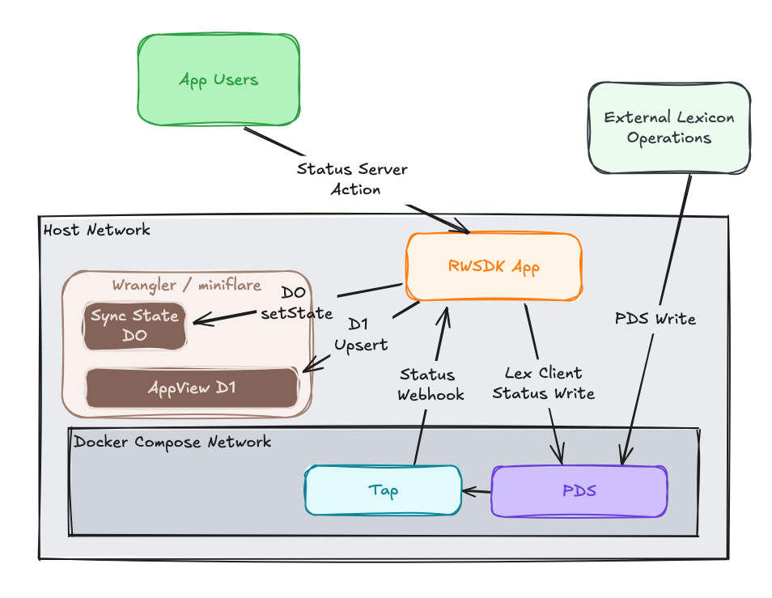
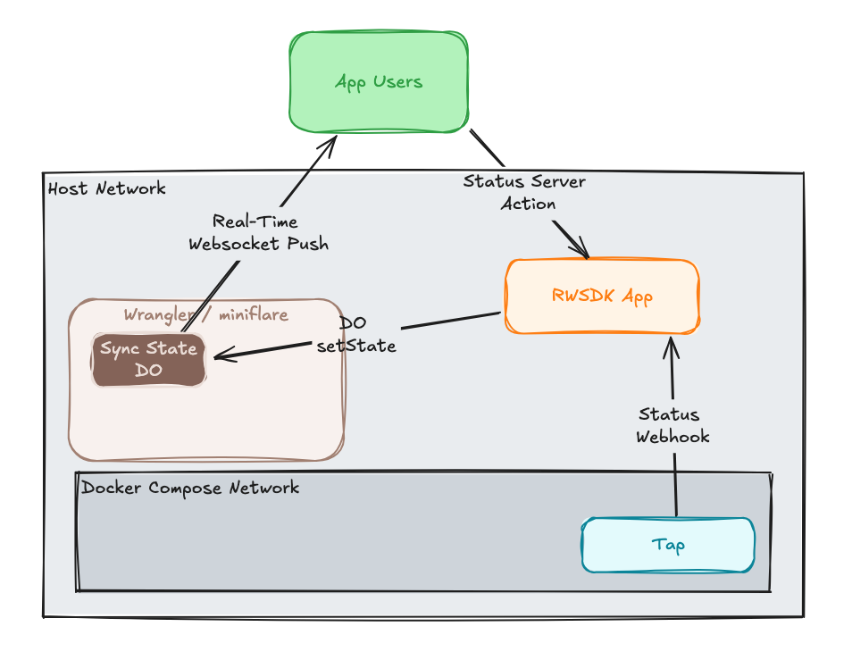
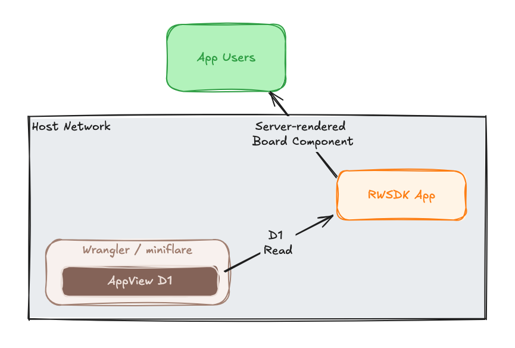

[Post 2](./rwsdk-atp-s2-p2-d1-persistence) wired D1 into the write path — every incoming status event now lands in a relational database. This post reads from it in a way that starts to look like a real [AppView](https://atproto.com/guides/glossary#app-view).

The three things this post adds: an aggregate query over D1, improved handle resolution that works against any PDS on the network, and a cold-start bootstrap that seeds the Durable Object from D1 so the live feed isn't empty when a DO instance starts fresh.

## What an AppView is

In the AT Protocol stack, an AppView is a service that indexes records from the firehose and serves aggregated data to clients. Bluesky itself is an AppView — it consumes the full firehose, indexes everything, and exposes that index through its API.

Our app is a much simpler version of this: it subscribes to a specific collection (`xyz.statusphere.status`) via Tap, stores incoming records in D1, and queries that store. The architectural pattern is the same even if the scale is very different.

The key shift introduced in this post is that we're no longer reading from individual PDSs on demand. We're reading from our own index.

## Aggregating from D1

The first read-from-D1 feature is a "top picked" panel: which emoji statuses have been picked most often, across all users.

```typescript
// src/db/statuses.ts
export async function getPopularStatuses(limit = 8) {
  const readDb = await db.getReader();
  return readDb
    .select({ status: statuses.status, count: count() })
    .from(statuses)
    .groupBy(statuses.status)
    .orderBy(desc(count()))
    .limit(limit);
}
```

This is called server-side in `PostContent` and passed into a `PopularStatuses` component that renders it on the page. It's server-rendered on each page load so there are no real-time updates, no WebSocket, just a SQL query. This is the point: some things are better as a query over a persistent store than as a push from a live connection. And it starts to peek into the world of [React Server Components](https://docs.rwsdk.com/core/react-server-components) that RWSDK can help provide.

## Fixing handle resolution

In Series 1, resolving a handle from a DID was a direct call to the local PDS's `describeRepo` endpoint. That only works for DIDs that live on that specific PDS. In production, a user's DID might be hosted on bsky.social, or their own self-hosted PDS, or anywhere. The better resolution path is: look up the DID document to find the user's PDS URL, then call `describeRepo` against that PDS.  This code allows the local docker-based setup to keep working but falls back to the production pattern if the environment variable is not present.

```typescript
// src/app/api/webhooks-tap.ts
async function resolveHandle(did: string): Promise<string | null> {
  try {
    let didDoc: DidDocument;
    if (did.startsWith("did:plc:")) {
      const plcUrl = env.ATPROTO_PLC_URL || "https://plc.directory";
      const res = await fetch(`${plcUrl}/${did}`);
      if (!res.ok) return null;
      didDoc = (await res.json()) as DidDocument;
    } else if (did.startsWith("did:web:")) {
      const domain = did.slice("did:web:".length);
      const res = await fetch(`https://${domain}/.well-known/did.json`);
      if (!res.ok) return null;
      didDoc = (await res.json()) as DidDocument;
    } else {
      return null;
    }

    const pdsService = didDoc.service?.find(
      (s) => s.type === "AtprotoPersonalDataServer" && s.id.endsWith("#atproto_pds"),
    );
    if (!pdsService?.serviceEndpoint) return null;

    const res = await fetch(
      `${pdsService.serviceEndpoint}/xrpc/com.atproto.repo.describeRepo?repo=${did}`,
    );
    const data = (await res.json()) as { handle?: string };
    return data.handle ?? null;
  } catch {
    return null;
  }
}
```

In the local dev stack, `ATPROTO_PLC_URL` points at the local PLC container, so `did:plc:` DIDs still resolve correctly. In production (where `ATPROTO_PLC_URL` is unset), it falls back to `plc.directory`. Either way the rest of the resolution is the same.

## Seeding the DO from D1 on cold start

The Durable Object holds the live status map in memory. When a DO instance starts fresh (new deploy, eviction, first start) that in-memory state is empty. Clients connecting at that moment see no statuses until the next webhook event arrives and slowly it'll build back up to a reasonable number of entries.

To provide a better experience in these situations we can seed the in-memory map from D1 on cold start using the DO's `blockConcurrencyWhile` hook, which runs once before the instance serves any requests:

```typescript
// src/app/durable-objects/appview-sync-state.ts
export class AppViewSyncState extends SyncedStateServer {
  constructor(...args: ConstructorParameters<typeof SyncedStateServer>) {
    super(...args);
    args[0].blockConcurrencyWhile(async () => {
      if (this.getState("statusMap")) return; // already warm
      try {
        await this.seedFromD1();
      } catch {
        // Seeding is best-effort — the DO still functions if D1 is unavailable
      }
    });
  }

  private async seedFromD1() {
    const rows = await readDb.select({ did, status, receivedAt, handle })
      .from(statuses)
      .leftJoin(users, eq(statuses.did, users.did))
      .orderBy(desc(statuses.receivedAt));

    // Build a latest-status-per-user map from newest-first rows
    const map: Record<string, StatusEntry> = {};
    for (const row of rows) {
      if (!map[row.did]) {
        map[row.did] = { did: row.did, handle: row.handle ?? null,
          status: row.status, updatedAt: row.receivedAt };
      }
    }
    this.setState(map, "statusMap");
  }
}
```

After this, a cold-started DO immediately has the latest status for every user we've indexed, before serving its first WebSocket connection. The `blockConcurrencyWhile` call ensures no requests are processed until seeding completes.

## Moving status writes to a server action

This post also refactors the status write path. Previously, the `StatusPicker` component called a `POST /status` API route. That route is replaced with a [server action](https://docs.rwsdk.com/core/server-actions/) to be more aligned to RWSDK's architecture and React Server Component-powered optimizations.

```typescript
// src/app/actions/status.ts
"use server";

export async function setStatus(status: string): Promise<SetStatusResult> {
  const { ctx } = requestInfo as unknown as { ctx: AppContext };
  const did = ctx.session?.did;
  if (!did) return { success: false, error: "unauthorized" };

  const oauthClient = await getOAuthClient();
  const oauthSession = await oauthClient.restore(did);
  const lexClient = new Client(oauthSession);
  const createdAt = new Date().toISOString() as DatetimeString;

  const res = await lexClient.create(statusSchema, { status, createdAt });
  return { success: true, uri: res.uri, createdAt };
}
```

The `"use server"` directive marks this as a server action — it runs on the Worker, has access to `requestInfo` and session context, and is called directly from the client component. No manual fetch, no JSON serialization of the request body, no API route to maintain.

## The page structure

The home page now has three distinct sections reflecting the three data sources:

1. **Set your status** — writes a record to your PDS (only shown when logged in)
2. **Top picked** — aggregate query from D1, server-rendered
3. **Current statuses** — live feed from the Durable Object WebSocket

This separation makes the data flow easier to follow: D1 for aggregation, DO for live updates.

## The companion code

The [`post/series-2/03-appview-features`](https://github.com/arsdehnel/rwsdk-atproto-starter/tree/post/series-2/03-appview-features) branch has the complete changes. The diff from the previous post is in [this PR](https://github.com/arsdehnel/rwsdk-atproto-starter/pull/102).

## Status reads, writes, and resiliency

Since the overall architecture didn't really change in this post we're zooming in on a set of data flows for how AppView read, write, and resiliency operations are handled.

### Status write operations

This view focuses just on where the _write_ operations are happening when a user writes a status either through our app (on the left through the dark green box representing a browser) or through another means or app (represented by the lighter green box on the right).  **Note:** I had to flip the positioning of PDS and Tap on this diagram to avoid arrow chaos, sorry to be inconsistent with the previous post diagrams!



### Status board real-time flow

I realize this is an oversimplification but trying to focus in on the parts that matter for the Status Board showing real-time operations. The expected path is just that a user selects a status, which RWSDK's hook writes to DO and all the users get it. The Tap hook and DO `setState()` are here to help manage external user updates and the first-time handle resolution which happens once per user in our app.  These are important features of our app and the ATP but they are not the primary flow for data. 

It's worth noting, too, that the capturing of the external data in our real-time board doesn't require additional operations here.  We already need to listen for the hooks for our own operations and we get the additional data from other apps/data sources using our lexicon for free.



### Top-statuses view

Since we included another data access pattern here for pulling data out of D1 into a "top statuses" board it might be useful to see how that looks from a data flow perspective.  This is pretty simple since it is rendered on page load rather than managing data in real-time.  Whether or not you keep it this simple with your feature is up to you. 

Note here how our board view has no immediate external ATP dependencies.  If we lose the Tap/Relay connection our data slowly becomes stale but our app can continue to function.  



## Up Next

The app is feature-complete. [Post 4](./rwsdk-atp-s2-p4-deploy-prep) is about wiring up the production configuration — Cloudflare environments, secrets, and getting `wrangler deploy` to a real Workers URL.
