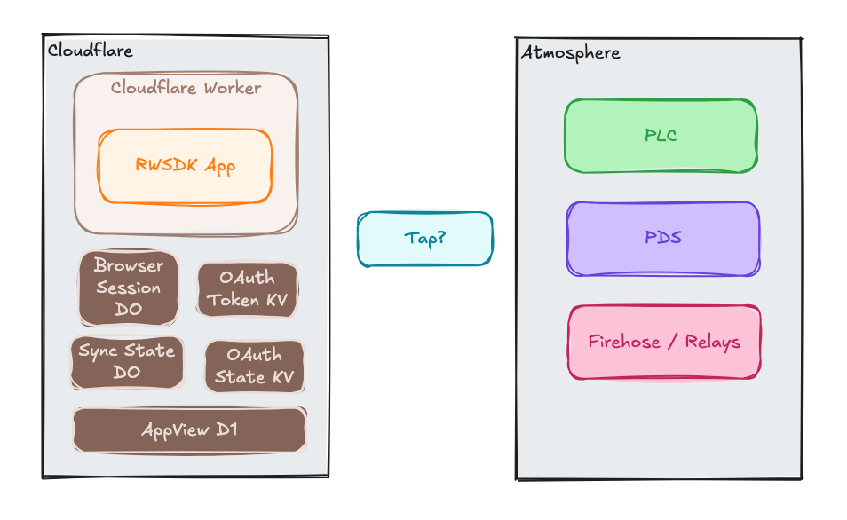

The app is feature-complete (or at least complete enough for a demo). OAuth works against any AT Protocol PDS, records land in D1, and the live feed pushes updates to connected clients. This post is about getting all of that running on a real Cloudflare Workers URL instead of `localhost`.

The short version of what changes: Wrangler environments replace the single `vars` block, real infrastructure IDs replace the local placeholders, and secrets get set via `wrangler secret put`. The application code itself doesn't change.

## Wrangler environments

The [`wrangler.jsonc`](https://developers.cloudflare.com/workers/wrangler/configuration/) from the original RWSDK `create` starter command had a single `vars` block with `ATPROTO_PDS_URL` and friends pointing at `localhost`. That works for local dev but deployed environments need different values.

Wrangler [environments](https://developers.cloudflare.com/workers/wrangler/configuration/#environments) let you define separate configuration blocks for different deployment targets. For demonstration purposes we're going to setup this repo to have three: `integration`, `staging`, and `production`. Each needs its own:

- `APP_URL` — the public URL for the deployed Worker (controls which OAuth client mode is used)
- KV namespace ID — for `KV_OAUTH_STATE`
- D1 database ID — for `DB`
- Durable Object bindings — `DO_APPVIEW_SYNC_STATE` and `DO_OAUTH_TOKEN`

```jsonc
// wrangler.jsonc (simplified)
"env": {
  "production": {
    "vars": {
      "APP_URL": "https://rwsdk-atproto-starter-production.your-account.workers.dev"
    },
    "kv_namespaces": [
      { "binding": "KV_OAUTH_STATE", "id": "<production-kv-namespace-id>" }
    ],
    "d1_databases": [
      {
        "binding": "DB",
        "database_name": "rwsdk-atproto-starter-production",
        "database_id": "<production-d1-database-id>",
        "migrations_dir": "drizzle"
      }
    ],
    "durable_objects": {
      "bindings": [
        { "name": "DO_APPVIEW_SYNC_STATE", "class_name": "AppViewSyncState" },
        { "name": "DO_OAUTH_TOKEN", "class_name": "OAuthToken" }
      ]
    }
  }
}
```

The root-level `vars` block only contains the local dev values (`ATPROTO_PDS_URL`, `ATPROTO_PLC_URL`). Those are intentionally absent from the deployed environments — without them, the app falls back to production AT Protocol infrastructure: `bsky.social` for handle resolution and `plc.directory` for DID lookups.

## First-time environment setup

For each environment you want to deploy to, run these once:

```sh
# Create the D1 database
wrangler d1 create rwsdk-atproto-starter-<environment-name>

# Create the KV namespace
wrangler kv namespace create KV_OAUTH_STATE --env <environment-name>
```

Both commands output an ID. Copy those into the `wrangler.jsonc` placeholders, then set `APP_URL` to what the actual deployed URL will be. Unless you're going to specify a custom domain in a [routes](https://developers.cloudflare.com/workers/configuration/routing/routes/) block this will be: `https://<worker-name>-<environment>.<account-name>.workers.dev` (ie `https://rwsdk-atproto-starter-integration.arsdehnel.workers.dev`).

## Setting secrets

Secrets aren't in `wrangler.jsonc` (because they're secrets), instead they are generated via `wrangler secret put` and are stored encrypted in Cloudflare's secret store.

```sh
wrangler secret put OAUTH_STATE_KV_ENCRYPTION_KEYS --env <environment-name>
wrangler secret put OAUTH_TOKEN_KV_ENCRYPTION_KEYS --env <environment-name>
wrangler secret put WEBHOOK_TAP_SECRET --env <environment-name>
```

If you want a shortcut to generating values for each secret:

```sh
# BROWSER_SESSION_SIGNING_KEY — random hex string
node -e "console.log(require('crypto').randomBytes(32).toString('hex'))"

# OAUTH_STATE_KV_ENCRYPTION_KEYS and OAUTH_TOKEN_KV_ENCRYPTION_KEYS
# JSON array of base64-encoded 32-byte keys (supports key rotation; start with one)
node -e "console.log(JSON.stringify([require('crypto').randomBytes(32).toString('base64')]))"

# WEBHOOK_TAP_SECRET — random hex string (must match TAP_ADMIN_PASSWORD in your Tap deployment)
node -e "console.log(require('crypto').randomBytes(32).toString('hex'))"
```

The `.dev.vars` file (copied from `.dev.vars.example`) holds the local dev equivalents. They use obviously-insecure placeholder values that are fine for local dev but should never be committed to deployed environments.

## Running migrations

Apply D1 migrations to a deployed environment before the first deploy, and after any schema change:

```sh
wrangler d1 migrations apply DB --env <environment-name>
```

This uses the same Drizzle-generated migration files under `drizzle/` as the local setup — the same migrations, different database.

## Deploying

```sh
wrangler deploy --env <environment-name>
```

That's it. The `release` script in `package.json` wraps a build and deploy:

```sh
pnpm release
```

The first deploy creates the Worker. After that, Cloudflare handles routing to the deployed URL you set as `APP_URL`.

## What the local dev vars no longer do

With `APP_URL` set in the deployed environment, the OAuth client switches from loopback mode to the discoverable confidential client. The `ATPROTO_PDS_URL` and `ATPROTO_PLC_URL` vars are only present at the root level for local dev and deployed environments don't set them, so the OAuth client uses `bsky.social` for handle resolution and the handle resolver falls back to `plc.directory` for DID lookups.

## Tap & Relay

This is really the biggest remaining "gap" in making our app production-ready.  Locally we're using Tap in a container but that isn't part of this Wrangler/RWSDK deployment process.  Tap expects to be deployed to something like a small VPS, Railway, or other always-on hosting service.  It has a pretty low compute requirement but it holds an open connection to a Relay which is just not what Cloudflare's Workers are specialized to do.  

To give you some options on where to go with this there are three options we'll outline.

### Cron in your worker

Run a cron/scheduled Worker process every 1 or 5 minutes that manages a cursor state against the firehose and pulls new events for your Lexicon since the last cron ran.  While it's not awesome for a full-scale production application, given my current state of affairs and how likely I am to have the next viral app I could see this being where I start and perhaps you should as well.  Since I'd expect _most_ (if not all) of my content to come through my app this should really be fine for a while as it only shows problems for data coming through the Tap/Relay that didn't originate in my application. 

### Run in Cloudflare Workers anyway

Even though it's not really the pattern that Cloudflare Workers were designed to handle the cost (at least for a small scale app) might actually be very small or even $0.  Depending on just how low usage your app is and how exactly you wire up the outgoing websocket connection you could probably get off the ground with this option.  I would say there is a good chance I'll try this out soon with my own starter app so if you're curious about a pure Cloudflare ATP AppView come back and see how that goes.  There are a few too many variables in the math to realistically predict exactly how much this'll end up costing but it seems entirely possible that for small-scale usage it'll stay free.

### Long-Lived Host

Realistically if you are _serious_ about your app this is your best bet.  Something like a small VPS, Fly.io, Railway, or similar could host Tap for a pretty small (but not $0) amount.  This would be the _right_ way to do it and would be how the architecture expects to run.  The [Tap readme](https://github.com/bluesky-social/indigo/blob/main/cmd/tap/README.md) has all the details on how to run this in various configurations.

## The companion code

There isn't much for code changes here but the [`post/series-2/04-deploy-prep`](https://github.com/arsdehnel/rwsdk-atproto-starter/tree/post/series-2/04-deploy-prep) branch has the full environment configuration including the updated readme with these commands and the `wrangler.jsonc` changes. The diff from the previous post is in [this PR](https://github.com/arsdehnel/rwsdk-atproto-starter/pull/103). The `README.md` on that branch has the complete first-time setup instructions.

## Deployed Architecture

Seems like it might be nice to get the full view of how this all works in production.  Kept the Cloudflare pieces in there and then included the public Atmosphere pieces as just single boxes even though many of those items are hosted in a distributed manner.



## Up Next

[Post 5](./rwsdk-atp-s2-p5-next-steps) is the final post in the series. After this post you're on you would have an app running in a deployed environment, the final post helps walk through what to think about before pointing it at real users and where you can take your RWSDK, ATP, and CF learning from here.
