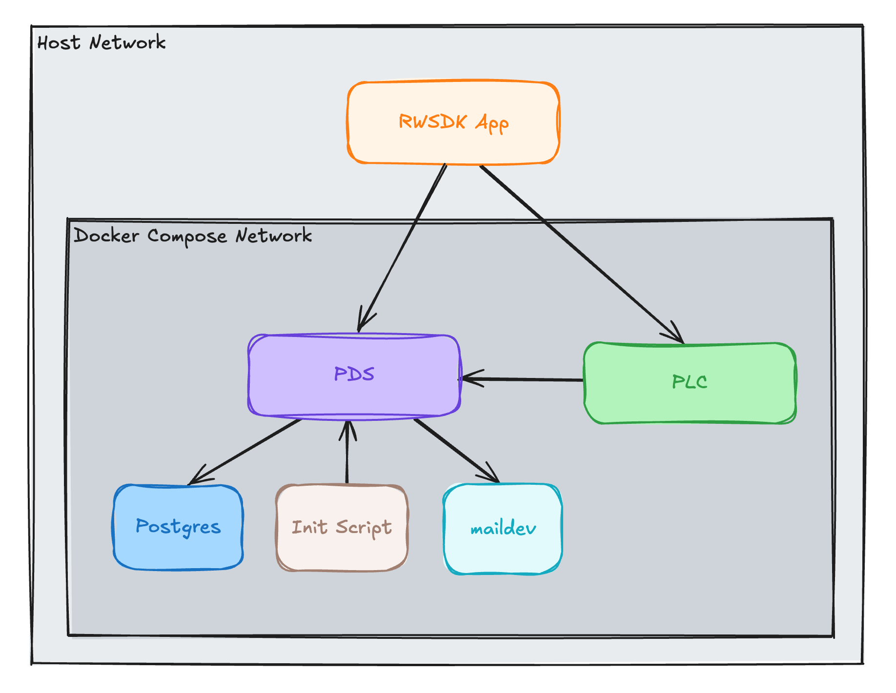
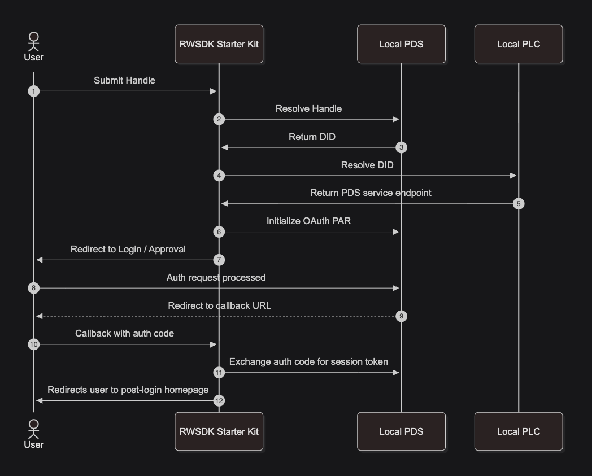

[Post 2](./rwsdk-atproto-02-atproto-oauth) got OAuth working against a real Bluesky account. Every time you clicked "Sign in" during that development cycle, your Worker resolved your handle against `bsky.social`, initiated a Pushed Authorization Request against it, and exchanged tokens with it. That's fine for a quick proof of concept, but it's not a sustainable way to develop. Not only are production rate limits real and every test creates audit trail entries on production infrastructure but as you start to build your own app logic you shouldn't be building that against production.  You wouldn't do it for traditional web apps and you shouldn't do it for Atmosphere apps.

Post 3 fixes that. By the end you'll have a local AT Protocol stack running in Docker: a PDS, a DID registry, an SMTP sink.  With that the OAuth login will work against it without touching any production infrastructure. 

**Full transparency:** the core pieces of this `docker compose` setup were pulled from [OpenMeet-Team's atproto-devnet](https://github.com/OpenMeet-Team/atproto-devnet) repo.

## What's actually running

Three services matter for this post:

[**PLC** is the DID registry](https://atproto.com/guides/the-at-stack#did-plc). When you create an account on AT Protocol, your identity is a `did:plc:*` identifier something like `did:plc:bcu5cnyeyel3u7rtghyg34vi`. Resolving that DID to a DID document (which contains your PDS's public URL and signing keys) goes through a PLC server. In production that's [`plc.directory`](https://web.plc.directory/). In our dev setup it needs to be local, because locally-created DIDs don't exist on the real `plc.directory`. The PLC server needs a Postgres database to store those records, so Postgres is in the stack too.

[**PDS** is the Personal Data Server](https://atproto.com/guides/the-at-stack#pds) where accounts and records actually live. The PDS we run locally is the same one Bluesky operates in production (`ghcr.io/bluesky-social/pds`), just pointed at our local PLC instead of the real one.

**maildev** is an SMTP sink. OpenMeet already includes this in their setup and it's a hard requirement because the PDS tries to send a welcome email on every account creation, even locally inside a Docker network. Without a running SMTP server account creation fails entirely. maildev accepts everything and exposes a web UI at port 1081 if you ever want to see what got sent.



## Some PDS env vars to note

After some trial and error, these three environment variables were ones to note that were the difference between the PDS working and not:

```yaml
PDS_HOSTNAME: localhost
PDS_DEV_MODE: "true"
PDS_DISABLE_SSRF_PROTECTION: "true"
```

Without `PDS_HOSTNAME: localhost` you get `BadRequestError: Invalid origin` during OAuth. The PDS validates that the `Origin` header in the browser's requests matches its configured public URL. Setting the hostname to `localhost` makes that URL `http://localhost:3000`, which matches what the browser sends.

Without `PDS_DEV_MODE: "true"` you get `Error: Resource URL must use the https scheme`. The OAuth spec requires resource metadata to be served over HTTPS. Dev mode bypasses that check, which lets the PDS serve its OAuth endpoints over plain HTTP.

Without `PDS_DISABLE_SSRF_PROTECTION: "true"` newer PDS builds (like the one we're using) added SSRF protection on outbound requests, which blocks the PDS from calling the local PLC server over an `http://` URL. Without this flag the PDS can't resolve DIDs from its own PLC, and account creation fails in a confusing way. OpenMeet had already worked this out; it's just worth knowing why it's there.

## Wiring the OAuth client to the docker compose-managed network

With Post 2's client pointed at `bsky.social`, three things need to change for the local dev setup:

```typescript
const { ATPROTO_PDS_URL: pdsUrl, ATPROTO_PLC_URL: plcUrl } = env;

const client = new NodeOAuthClient({
  handleResolver: pdsUrl,
  plcDirectoryUrl: plcUrl,
  allowHttp: pdsUrl.startsWith("http:"),
  // ...
});
```

**`handleResolver`** now points at the local PDS instead of `bsky.social`. The PDS has its own `com.atproto.identity.resolveHandle` endpoint and can resolve handles it knows about (like the `alice.devnet.test` account that is seeded in our setup) directly without touching any external service.

**`plcDirectoryUrl`** overrides the default `https://plc.directory`. Without this, the OAuth client resolves `did:plc:*` identifiers against the real public PLC directory, which has never heard of your local test accounts.

**`allowHttp`** tells the OAuth client to accept `http://` URLs for OAuth server metadata and token endpoints. The default is to reject them as insecure. Since `PDS_DEV_MODE` makes the PDS serve over HTTP, the client needs to accept that.

The env vars are set in `wrangler.jsonc` and can be overridden with `.dev.vars` for local use:

```jsonc
"ATPROTO_PDS_URL": "http://localhost:3000",
"ATPROTO_PLC_URL": "http://localhost:2582"
```

To read them in the Worker, `import { env } from "cloudflare:workers"` is the clean approach as it means no threading through function parameters is required.

## A gotcha worth knowing: the two-URL split

One complication this post sidesteps but you'll run into it if you ever containerize your Worker in addition to the backend network we have here.  The URL your Worker uses to reach the PDS internally and the URL the browser uses to reach it are different things.

The PDS thinks its canonical URL is `http://localhost:3000` (because `PDS_HOSTNAME: localhost`). That URL appears in DID documents as the `serviceEndpoint`, and the browser can reach it via Docker's port forwarding. But if your Worker is running inside a Docker container on the same network, `localhost:3000` inside that container resolves to the container's own loopback not the PDS container. You'd need `pds:3000` for server-side fetches while the browser still sees `localhost:3000`.

The way to handle that is a fetch wrapper that rewrites the canonical URL to the Docker-internal URL for server-side requests. This post runs the Worker on the host dev machine with `pnpm dev`, so the split doesn't apply; `localhost:3000` reaches the Docker-forwarded PDS port from both the browser and the Worker process. But if you extend this setup to containerize the Worker, that's the thing to solve.

## The init script

The Docker Compose stack includes a one-shot Alpine container that runs after the PDS is healthy. OpenMeet ships `scripts/init.sh` that does this (creates an invite code via the admin API, seeds three test accounts, and writes credentials to `data/accounts.env`). We used that as the starting point and adapted it for our setup mostly as a result of hitting some errors and having the script swallow the results.  

The OpenMeet script uses `curl -sf` (the `-f` flag causes curl to exit non-zero on HTTP error responses) combined with `set -eu` at the top of the script which means any failed account creation silently kills the whole script. The invite code would get created, account creation would fail, and the only evidence would be that `data/accounts.env` only contained the invite code line. Switching to `-s` and handling the error outside of the curl command (via the response body) made that work a little more nicely for debugging.

Account credentials get written to `data/accounts.env` after the first `pnpm docker:up`. The full startup sequence is:

```sh
pnpm docker:up
pnpm dev
```

Then log in with `alice.devnet.test` / `alice-devnet-pass`.

## The proof

After logging in, the app fetches `com.atproto.repo.describeRepo` from the local PDS and displays the raw response. The key field is in the DID document:

```json
{
  "service": [{
    "id": "#atproto_pds",
    "type": "AtprotoPersonalDataServer",
    "serviceEndpoint": "http://localhost:3000"
  }]
}
```

`serviceEndpoint: "http://localhost:3000"` confirms the whole chain is working: the handle resolved against the local PDS, the DID was issued by the local PLC, and the OAuth session was established against local infrastructure. Nothing touched production.

## The companion code

The [`post/03-local-dev-setup`](https://github.com/arsdehnel/rwsdk-atproto-starter/tree/post/03-local-dev-setup) branch has the end result of all of this (the full Docker Compose setup, init script, and OAuth client changes). To specifically look at the changes we made here in Step 3 compared to the end result of Step 2 [this PR](https://github.com/arsdehnel/rwsdk-atproto-starter/pull/10) shows that nicely.

## Current flow diagram

The actual flow here doesn't change much from Post 2: all we really changed was moving all the public services into a docker compose network.  The Bluesky and PDS capabilities were folded into just our local PDS and our local PLC replaced the public one.



## Up Next

Wrapping up we have our [`post/03-local-dev-setup`](https://github.com/arsdehnel/rwsdk-atproto-starter/tree/post/03-local-dev-setup) branch with the current state of things as of the end of this post.  And as we've done before we have [the Step 3 Additions PR](https://github.com/arsdehnel/rwsdk-atproto-starter/pull/10) for what's been changed in this step since step 2.

[Post 4](./rwsdk-atproto-04-atproto-writes) gets into lexicons and writing records and comes back to that OAuth token store we setup last post both being useful and having some problems with our original implementation.