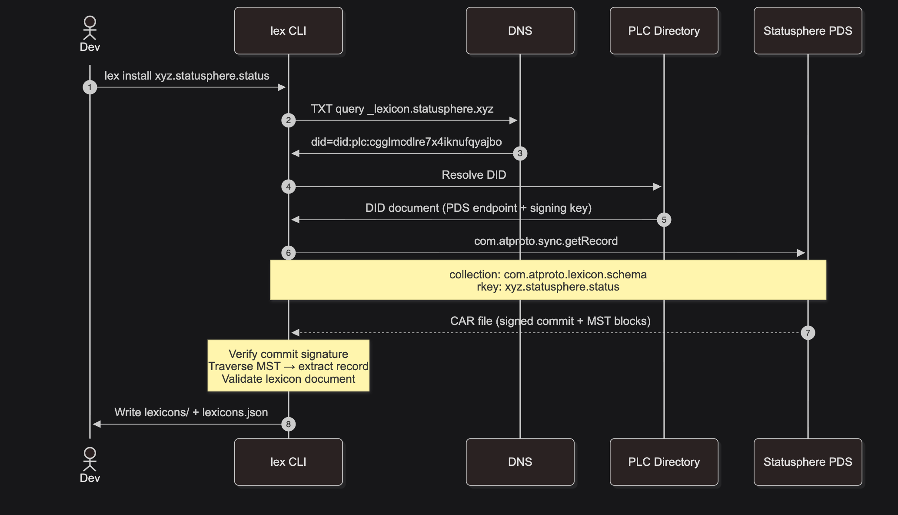
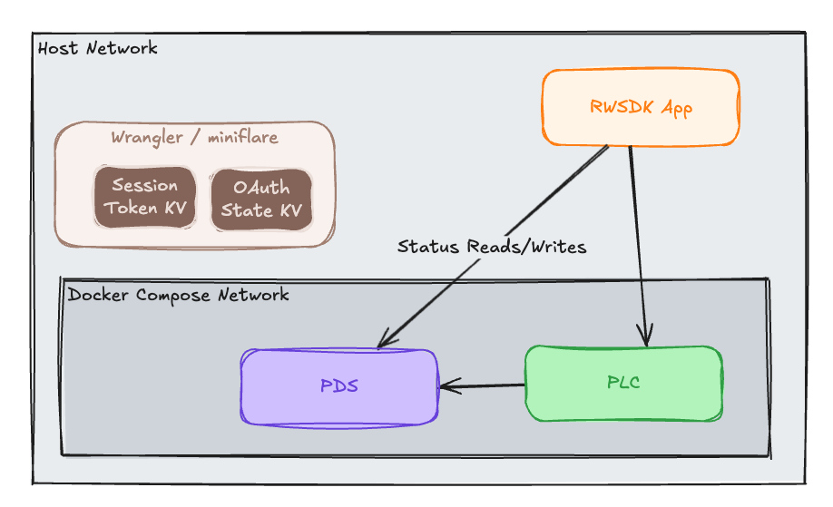

[Post 3](./rwsdk-atproto-03-local-dev-setup) set up a local AT Protocol development environment so nothing has to touch Bluesky or anything on the ATmosphere during development. Building on that we start getting into actual feature development. As a part of that we need to write some data which means we define a lexicon, generate TypeScript from it, and write an actual record to the local PDS. In doing this we'll hit the OAuth token problem we mentioned in [Post 2](./rwsdk-atproto-02-atproto-oauth) so we'll solve that while we're adding our Status Emoji feature, too.

## What a lexicon is

Every record type in AT Protocol is defined by a [lexicon](https://atproto.com/guides/lexicon): a JSON schema identified by [an NSID (Namespace Identifier)](https://atproto.com/specs/nsid). NSIDs follow a reverse-DNS convention: `xyz.statusphere.status` means the `status` record type under the `statusphere` namespace, owned by whoever controls `statusphere.xyz` (proven by a DNS TXT record). The NSID doubles as the [collection](https://atproto.com/guides/glossary#collection) name when records are stored in a [repo](https://atproto.com/specs/repository).

The `xyz.statusphere.status` lexicon comes from Bluesky's [Statusphere tutorial](https://atproto.com/guides/statusphere-tutorial). It defines a simple record: one emoji status and a timestamp.

```json
{
  "lexicon": 1,
  "id": "xyz.statusphere.status",
  "defs": {
    "main": {
      "type": "record",
      "key": "tid",
      "record": {
        "type": "object",
        "required": ["status", "createdAt"],
        "properties": {
          "status": { "type": "string", "maxGraphemes": 1, "maxLength": 32, "minLength": 1 },
          "createdAt": { "type": "string", "format": "datetime" }
        }
      }
    }
  }
}
```

The `key: "tid"` field means records in this collection are identified by a [TID (timestamp-based ID)](https://atproto.com/specs/tid). We'll override that in a moment to make it behave as a singleton.

## Installing and generating

**Note:** For this part we're largely just re-explaining [the Statusphere Tutorial](https://atproto.com/guides/statusphere-tutorial#part-1-lexicons) from atproto.com.  

The [`@atproto/lex` package](https://www.npmjs.com/package/@atproto/lex) ships a CLI with two commands:

```sh
lex install xyz.statusphere.status   # fetches the lexicon JSON from the network
lex build                            # generates TypeScript from the fetched JSON
```

`lex install` fetches the lexicon from where it lives in the AT Protocol network. In this case that is a record published by the Statusphere tutorial authors.  The results are written to `lexicons.json` as sort of a "lexicons lock file":

```json
{
  "version": 1,
  "lexicons": ["xyz.statusphere.status"],
  "resolutions": {
    "xyz.statusphere.status": {
      "uri": "at://did:plc:cgglmcdlre7x4iknufqyajbo/com.atproto.lexicon.schema/xyz.statusphere.status",
      "cid": "bafyreifmakho22qjptfycciab2gm6hyl4yeav7b2sp6us2ndotavqn4qgi"
    }
  }
}
```

## Quick peek behind the scenes

You can skip this section if you want, but since the AT Protocol is new to me I dug into what all is happening here.  Needless to say it's a little more than just downloading some JSON!



**Key Points**
- Step 2 reverses the NSID's authority segment (xyz.statusphere → statusphere.xyz) to build the DNS query _lexicon.statusphere.xyz; Step 3 returns the DID that owns that authority
- Step 4 uses the same PLC resolution for these lexicon records as the OAuth resolution flow did in Post 2 showing this is how the ATP works, not just for OAuth
- Step 6 actually fetches the lexicon but importantly we have the means to cryptographically verify the PDS is returning the appropriate document and the `lex` CLI non-optionally does this for us

## Handling the results

Back to our local repo the produced `lexicons.json` should get committed as it tracks the version your code is developed against and where to find the lexicons for future builds and contributors. In addition to this file the actual JSON files that hold the schemas are fetched into `lexicons/` and should be gitignored. Following that `install` command run `lex build` to generate the TypeScript definitions for those schemas into `src/lexicons/` and gitignore those as well. They're both reproducible build artifacts, not source. It's your call on if you want to add a script to `package.json` for them but we decided to include it and even add them to the `dev:init` script rwsdk calls so a fresh clone is one command away:

```jsonc
"dev:init": "pnpm lex:install && pnpm lex:generate && rw-scripts dev-init",
"lex:install": "lex install --ci",
"lex:generate": "lex build --import-ext \"\"",
```

The `--ci` flag on `lex install` pins behavior to the CIDs in `lexicons.json` rather than re-resolving — same idea as `npm ci` vs `npm install`.

**Note:** If you're in an air-gapped setup this will fail as these commands make calls to the internet.  Perhaps commit these files in that case or figure out another path.

## What gets generated

`lex build` outputs a TypeScript representation of the lexicon under `src/lexicons/`. The interesting file is `xyz/statusphere/status.defs.ts`:

```typescript
const main = l.record<'tid', Main>(
  'tid',
  'xyz.statusphere.status',
  l.object({
    status: l.string({ maxLength: 32, minLength: 1, maxGraphemes: 1 }),
    createdAt: l.string({ format: 'datetime' }),
  }),
)
```

This `main` object is the schema that the `@atproto/lex` `Client` class uses for typed reads and writes. `status.ts` re-exports it as the default export, which is what gets imported in application code.

## Writing a record

The `@atproto/lex` `Client` wraps an OAuth session and provides high-level methods for record operations: `create`, `put`, `get`, `list`, `delete`. Each takes a schema object as its first argument, which is how it knows the NSID, key type, and shape of the record.

For `xyz.statusphere.status` we want a singleton per user (one record updated in place rather than appended). AT Protocol has no PATCH operation; `put` replaces the record wholesale. The singleton behavior comes from using a fixed [`rkey`](https://atproto.com/specs/record-key) of [`"self"`](https://atproto.com/specs/record-key#record-key-type-literal-value) which is a known and common value, not just a constant string picked for this particular use case:

```typescript
import { Client, type DatetimeString } from "@atproto/lex";
import statusSchema from "@/lexicons/xyz/statusphere/status";

const oauthSession = await oauthClient.restore(did);
const lexClient = new Client(oauthSession);

const res = await lexClient.put(
  statusSchema,
  { status: emoji, createdAt: new Date().toISOString() as DatetimeString },
  { rkey: "self" }
);
```

Any future `put` with the same `rkey` replaces the previous record. The [`lexicon: "tid"`](https://atproto.com/specs/tid) key type still applies for new records created without an explicit rkey we're just overriding it for this one.

The lower-level API (`createRecord`, `putRecord`, etc.) returns the full `XrpcResponse` object with the body under `.body`. The high-level methods (`put`, `get`, etc.) return the body directly, which is probably what you want in most cases.

## OAuth scope for writes

Post 2 and 3 use a scope of `"atproto"` which grants full repo access. For writes, a more specific scope should be requested so the user can feel more comfortable with the permissions request they'll need to approve (and because it's good practice to ask for only what you need).

```typescript
export const SCOPE = "atproto repo:xyz.statusphere.status";
```

The `repo:xyz.statusphere.status` scope explicitly requests write access to that collection. The PDS enforces this when the record is created; the access token must carry the scope that covers the collection being written to. Changing the scope means existing sessions are no longer valid for the new scope. Users need to log out and re-authenticate.

## The OAuth session storage problem

There's a lingering problem that's been deferred since Post 2 and that now actually breaks things: `NodeOAuthClient` needs a `stateStore` and `sessionStore` to persist OAuth state and tokens. The previous implementation used in-memory Maps on `globalThis`. This works within a single worker process session but falls apart the moment the worker restarts which happens constantly during development when files change.

The symptom: the `UserSession` Durable Object (which stores the HTTP session cookie → DID mapping) survives worker restarts because it's backed by SQLite. So the user still appears logged in. But the OAuth tokens stored in the in-memory Map are gone, so `client.restore(did)` throws "The session was deleted by another process" when the app tries to write a record.

The fix is two Cloudflare KV namespaces each with their own semantics and lifecycles.

```jsonc
"kv_namespaces": [
  { "binding": "OAUTH_STATE_KV", "id": "OAUTH_STATE_KV_LOCAL" },
  { "binding": "OAUTH_SESSION_KV", "id": "OAUTH_SESSION_KV_LOCAL" }
]
```

- State entries are ephemeral: OAuth flow state only needs to survive the seconds between the authorization redirect and the callback
- Session entries are durable: they need to survive restarts and (in production) isolate evictions

```typescript
stateStore: {
  async get(key) {
    const raw = await env.OAUTH_STATE_KV.get(key);
    return raw ? JSON.parse(raw) : undefined;
  },
  async set(key, value) {
    await env.OAUTH_STATE_KV.put(key, JSON.stringify(value), {
      expirationTtl: 600, // 10 minutes
    });
  },
  async del(key) { await env.OAUTH_STATE_KV.delete(key); },
},
sessionStore: {
  async get(did) {
    const raw = await env.OAUTH_SESSION_KV.get(did);
    return raw ? JSON.parse(raw) : undefined;
  },
  async set(did, value) {
    await env.OAUTH_SESSION_KV.put(did, JSON.stringify(value));
  },
  async del(did) { await env.OAUTH_SESSION_KV.delete(did); },
},
```

One remaining gap worth naming: in production, the `stateStore` is still not safe across multiple Worker isolates. The authorization redirect and OAuth callback are likely to land on different isolates, and KV reads are eventually consistent rather than strongly consistent. For a single-instance dev setup this is fine; for production the fix is either a Durable Object or accepting that some login attempts will fail and require a retry. [Post 8](./rwsdk-atproto-08-next-steps) covers making this production-ready.

## Reading back publicly

After writing, the app reads the status collection back from the PDS to display the raw record. This is the same sort of thing we did in [Post 1](./rwsdk-atproto-01-first-read) but now tied to our own app's data.  You can still just open this in your browser without OAuth or anything and see the record:

```
GET http://localhost:3000/xrpc/com.atproto.repo.listRecords?repo={did}&collection=xyz.statusphere.status
```

The write required authentication; the read doesn't. This is the AT Protocol data model: your repo is publicly readable by anyone, writes require OAuth authorization from you.

The response shows what the record actually looks like on the wire:

```json
{
  "records": [{
    "uri": "at://did:plc:.../xyz.statusphere.status/self",
    "cid": "bafyrei...",
    "value": {
      "$type": "xyz.statusphere.status",
      "status": "🔥",
      "createdAt": "2026-10-15T20:00:00.000Z"
    }
  }]
}
```

The `uri` is an [AT URI (`at://`) scheme](https://atproto.com/specs/at-uri-scheme), the [DID](https://atproto.com/specs/did) as the authority, the [NSID](https://atproto.com/specs/nsid) as the collection, the [rkey](https://atproto.com/specs/record-key) as the final segment. The [`cid`](https://atproto.com/specs/data-model#link-and-cid-formats) is a content-addressed hash of the record value, used for compare-and-swap operations. The `$type` field identifies the lexicon.

## The direct PDS read

The app reads the status back from the same PDS it just wrote to. This works, and it's fine for a demo — it'll even hold up at small scale in production. But as your app grows there are more idiomatic patterns worth knowing about.

In the real atmosphere, once you have confirmation from the PDS that a write succeeded, you already have the data — you don't need to ask for it back. And for reading data from other users, the right path is through [Relays](https://atproto.com/guides/the-at-stack#relays) that manage the firehose of events across the Atmosphere rather than polling each user's PDS directly. Your write will come back through these but there would be a delay — more on that in [Post 5](./rwsdk-atproto-05-tap-sync).

There's also a more fundamental reason to care about the relay: AT Protocol is an open ecosystem. Other apps can write records using the same lexicons, and those writes will never flow through your app at all. If you're only watching for writes that originate in your own UI, you're missing everything that happens outside it. The firehose is how you see the full picture.

## The companion code

The [`post/04-atproto-writes`](https://github.com/arsdehnel/rwsdk-atproto-starter/tree/post/04-atproto-writes) branch has the working code for this step ready to rock. To specifically look at the changes we made here in Step 4 compared to the end result of Step 3, take a look at [this PR](https://github.com/arsdehnel/rwsdk-atproto-starter/pull/11).

## Current architecture diagram

Removing the details of the docker setup (even though they still exist) from the diagram makes this one pretty simple.  We'll show the Wrangler-managed KV stores here since they were added in this step to solve the token management problem.  This is all still local to our machine since Wrangler is running these for us via miniflare. 



## Up Next

Alright that ended up to be a lot.  Take a look at [`post/04-atproto-writes`](https://github.com/arsdehnel/rwsdk-atproto-starter/tree/post/04-atproto-writes) branch to see the fully working version at this point.  The changes for this step are in [this PR](https://github.com/arsdehnel/rwsdk-atproto-starter/pull/11) if you're curious about that sort of thing.

Continuing our feature build [Post 5](./rwsdk-atproto-05-tap-sync) looks at the two patterns for handling reads in AT Protocol apps, when you'd reach for each, and wires up the relay side using Tap.