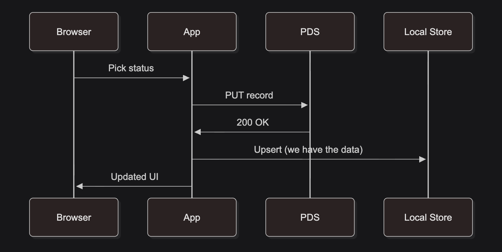
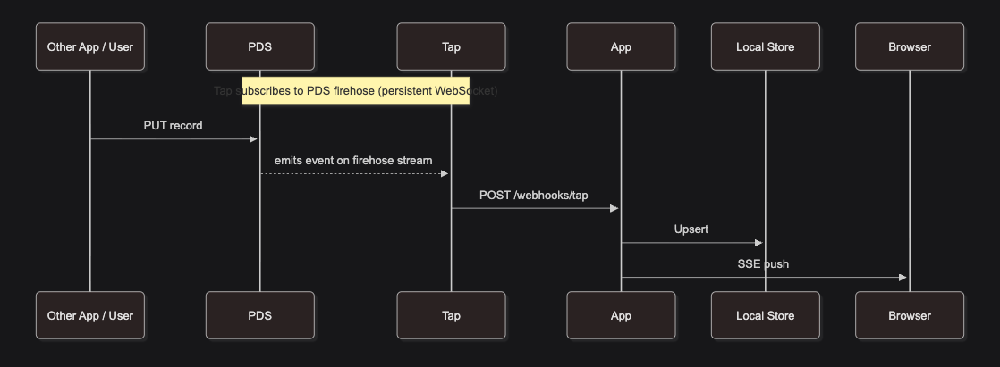
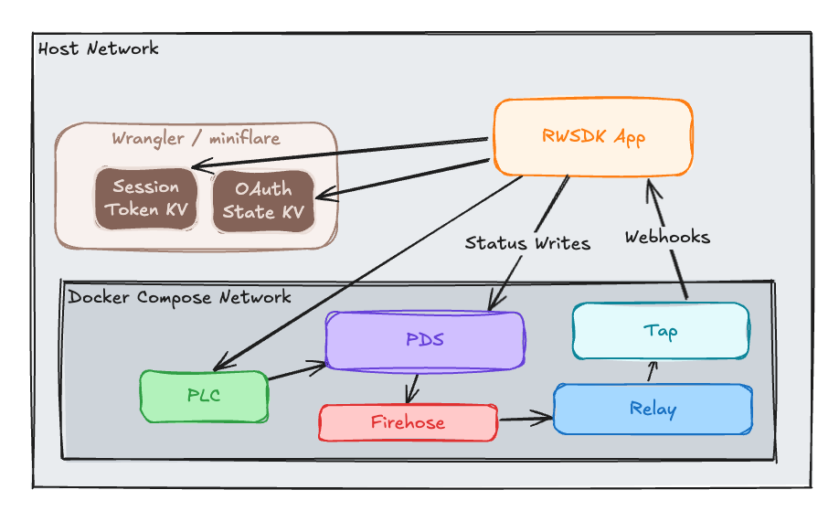

[Post 4](./rwsdk-atproto-04-atproto-writes) ended with the app reading a status record back from the PDS immediately after writing it. That works at small scale, but it misses a lot of what makes AT Protocol interesting. This post walks through the two idiomatic patterns for reads in ATP apps and implements the one that serves this series' flow more nicely (the relay side).

## Two patterns for reads in AT Protocol

There's no single right answer — there are two complementary patterns, and most apps use both.

**Optimistic update** when you write a record and the PDS confirms it, you already have the data. Update your local store immediately from what you sent rather than waiting for anything to come back from the network. The term `optimistic update` could be confusing to user here for developers used to updating a UI before the DB has the data.  This is a slightly different aspect of the architecture we're considering to be optimistically updating but the concept is the same.  The ultimate "source of truth" in the ATP is the Relay/Firehose so we're _optimistically_ using our local D1 database instead of waiting for the loop back.



This is fast — no extra round-trip, no relay delay — and correct for your own writes. Its limitation: it only covers writes that originate in your own app.

**Relay / firehose** — subscribe to [the firehose of events](https://atproto.com/guides/streaming-data) and update your store when records arrive.



This is the right path for other users' writes, and critically, for writes from external apps using the same lexicons — things your app never touched. There's a short relay delay, but you see the full picture.

Using only the relay works but your own writes feel slow. Using only optimistic updates misses everything that happens outside your app. Post 7 wires them together. For now, this post builds the relay side.

## The relay side: Tap

An [AppView](https://atproto.com/guides/the-at-stack#app-views) subscribes to [the firehose](https://atproto.com/guides/streaming-data), indexes the records it cares about, and serves reads against that index. [Tap](https://atproto.com/guides/the-at-stack#tap) is a lightweight component that handles the firehose subscription and delivers matching events to your app as HTTP webhooks — it's the relay half of the pattern above.

## Adding Tap to Docker Compose

```yaml
tap:
  image: ghcr.io/bluesky-social/indigo/tap:latest
  restart: unless-stopped
  depends_on:
    pds:
      condition: service_healthy
  environment:
    TAP_RELAY_URL: http://pds:3000
    TAP_PLC_URL: http://plc:2582
    TAP_DATABASE_URL: sqlite:///data/tap.db
    TAP_DISABLE_ACKS: "true"
    TAP_WEBHOOK_URL: ${TAP_WEBHOOK_URL:-http://host.docker.internal:5173/webhooks/tap}
    TAP_COLLECTION_FILTERS: xyz.statusphere.status
    TAP_LOG_LEVEL: info
  extra_hosts:
    - "localhost:host-gateway"
    - "host.docker.internal:host-gateway"
  volumes:
    - tap-data:/data
  ports:
    - "2480:2480"
  networks:
    - atproto-devnet
  healthcheck:
    test: ["CMD", "wget", "-q", "--spider", "http://127.0.0.1:2480/health"]
    interval: 60s
    timeout: 5s
    retries: 5
```

A few things worth explaining:

- **`TAP_WEBHOOK_URL`:** instead of the WebSocket channel mode (where your app connects to Tap), this puts Tap in webhook mode: it POSTs events to your app's URL. That's the right model for a Cloudflare Worker, which handles incoming requests rather than maintaining persistent outgoing connections. The default points at `host.docker.internal:5173`, which resolves to the host machine from inside the container — see `extra_hosts` below for how that's wired up.

- **`TAP_COLLECTION_FILTERS`:** Tap only delivers events for this collection. Everything else on the firehose is silently and conveniently dropped before the webhook fires.  Given that this is a local network for events it probably isn't necessary but it's a good pattern to establish regardless.

- **`extra_hosts`:** two entries, both using Docker's `host-gateway` special value which resolves to the host machine's IP regardless of platform (macOS, Linux, Windows). The first — `localhost:host-gateway` — is needed because the PDS registers itself as `http://localhost:3000` (that's what `PDS_HOSTNAME: localhost` does, and it's what makes OAuth work from your browser). When Tap later resolves a user's DID document, it finds `localhost:3000`. Inside the container `localhost` means the container itself, not the host — so without this mapping every repo resync attempt fails with connection refused. The second — `host.docker.internal:host-gateway` — makes the `TAP_WEBHOOK_URL` default work everywhere: Docker Desktop provides `host.docker.internal` automatically on macOS and Windows, but on Linux with Docker Engine you need the explicit mapping.

- **`TAP_DISABLE_ACKS: "true"`:** in development, fire-and-forget delivery is fine. Acks are for production reliability.

- **`TAP_SIGNAL_COLLECTION`** the [Statusphere tutorial](https://atproto.com/guides/statusphere-tutorial) uses `--signal-collection` to tell Tap to automatically discover any repo on the network that has records in a given collection. That's a useful production feature for indexing the full network but it doesn't work against our local setup. The discovery mechanism calls the `listReposByCollection` xrpc endpoint on the PDS but that's not really a PDS endpoint so the PDS we're using proxies that off to a Relay... or at least it tries to.  It checks for authentication first which is what results in the 401 but even if we provided auth to get through that check the upstream call to a Relay would fail because we don't have a Relay running.  Even if we did add the auth _and_ the Relay I think the "register PDSs on user login" for this demo and starter kit is cleaner and easier to understand.  Given that this is not part of the AppView that you'll be deploying at the end of all of this it's not a production worry, either. 

- **Vite Networking in Docker:** Tap's webhook POST arrives at the Vite dev server with `Host: host.docker.internal:5173`. Vite only responds to `localhost` and `*.localhost` domains [by default](https://vite.dev/config/server-options#server-allowedhosts). Adding the docker host to the `allowedHosts` lets requests through to the worker dev server, the fix is one line in `vite.config.mts`:

    ```typescript
    server: {
      host: "127.0.0.1",
      allowedHosts: ["host.docker.internal"], // <-- this one is the new line to add
    },
    ```

## Registering repos with Tap

Since we can't use `TAP_SIGNAL_COLLECTION` locally, Tap only watches repos it's been explicitly told about.  The right time to register a user's repo is right after they log in — the OAuth callback is already the place where you know a user just authenticated:

```typescript
// src/app/api/oauth-callback.ts
export async function get({ request, response }: RequestInfo) {
  const client = await getOAuthClient();
  const { session } = await client.callback(new URL(request.url).searchParams);

  await sessionStore.save(response.headers, { did: session.did });

  try {
    await fetch(`${env.ATPROTO_TAP_URL}/repos/add`, {
      method: "POST",
      headers: { "Content-Type": "application/json" },
      body: JSON.stringify({ dids: [session.did] }),
    });
  } catch {
    // Tap may not be running. Non-fatal: the feed just won't update live.
  }

  response.headers.set("Location", "/");
  return new Response(null, { status: 302, headers: response.headers });
}
```

`ATPROTO_TAP_URL: "http://localhost:2480"` goes in `wrangler.jsonc`. The call is wrapped in try/catch because this deployment doesn't have a Tap deployment included and this will allow the code to be shipped to a production app as the feed simply won't update live, which is the correct graceful degradation.  Although there are several places the code in this blog series needs tweaks before going to prod.  More on those items in [Post 8](./rwsdk-atproto-08-next-steps).

## The webhook endpoint

The [`@atproto/tap`](https://github.com/bluesky-social/atproto/blob/main/packages/tap/README.md) npm package ships a `parseTapEvent` helper that validates and parses the JSON body Tap POSTs:

```typescript
import { parseTapEvent } from "@atproto/tap";
import type { LexValue } from "@atproto/lex";

export async function post({ request }: RequestInfo): Promise<Response> {
  const body = await request.json();
  const event = parseTapEvent(body as LexValue);

  if (event.type !== "record" || event.collection !== "xyz.statusphere.status") {
    return new Response("ok");
  }

  if (event.action === "delete") {
    statusStore.delete(event.did);
  } else {
    const handle = await resolveHandle(event.did);
    statusStore.set(event.did, {
      did: event.did,
      handle,
      status: event.record?.status as string,
      updatedAt: new Date().toISOString(),
    });
  }

  pushToSseClients(Array.from(statusStore.values()));
  return new Response("ok");
}
```

`parseTapEvent` covers two event types: `record` (create, update, delete for a specific record) and `identity` (handle changes, account status). We only care about `record` events for our collection. The handle resolution is a best-effort `describeRepo` call to the PDS (the DID is guaranteed, the handle is display metadata).

## In-memory state and SSE

In this initial build of the app the statuses are stored in a module-level Map stored in memory. We'll use [Server-Sent Events](https://developer.mozilla.org/en-US/docs/Web/API/Server-sent_events) (SSE) within `workerd` to push these changes out to connected clients/browsers. SSE is a browser-native API for receiving a stream of updates over a single HTTP connection — lighter than WebSockets for this one-way push use case.

```typescript
export const statusStore = new Map<string, StatusEntry>();
export const sseClients = new Set<ReadableStreamDefaultController<Uint8Array>>();
```

Module-level state in a Cloudflare Worker is shared within a single isolate for the lifetime of that isolate. In `pnpm dev` that means every time you save a file you get a new isolate and the in-memory state is empty. It's not shared across isolates in a multi-worker production deployment, and it doesn't survive restarts. That's intentional for this post — we're demonstrating the event-driven pattern, not the persistence layer.

The SSE endpoint returns a streaming response and registers the controller:

```typescript
export function get(): Response {
  const encoder = new TextEncoder();
  let ctrl: ReadableStreamDefaultController<Uint8Array>;

  const stream = new ReadableStream<Uint8Array>({
    start(controller) {
      ctrl = controller;
      sseClients.add(ctrl);
      const all = Array.from(statusStore.values());
      ctrl.enqueue(
        encoder.encode(`event: statuses\ndata: ${JSON.stringify(all)}\n\n`)
      );
    },
    cancel() {
      sseClients.delete(ctrl);
    },
  });

  return new Response(stream, {
    headers: {
      "Content-Type": "text/event-stream",
      "Cache-Control": "no-cache",
    },
  });
}
```

When the webhook fires, the handler calls `ctrl.enqueue()` on all registered controllers to push the updated list to every open browser connection.

### The workerd compatibility flag

Cloudflare's workerd runtime enforces strict request context isolation. When the SSE GET response starts streaming, workerd marks that request as completed. When the webhook POST later calls `ctrl.enqueue()`, it's operating on a stream from a different (now-completed) request context, and workerd cancels the continuation by default.

The fix is one line in `wrangler.jsonc`:

```jsonc
"compatibility_flags": ["nodejs_compat", "no_handle_cross_request_promise_resolution"]
```

`no_handle_cross_request_promise_resolution` tells workerd not to detect and cancel these cross-request continuations. The SSE push proceeds normally.

## The client component

A `"use client"` component opens an [`EventSource`](https://developer.mozilla.org/en-US/docs/Web/API/EventSource) connection and updates state on each event:

```typescript
"use client";

export function StatusFeed({ initialStatuses }: { initialStatuses: StatusEntry[] }) {
  const [statuses, setStatuses] = useState(initialStatuses);

  useEffect(() => {
    const es = new EventSource("/api/statuses/sse");
    es.addEventListener("statuses", (e) => {
      setStatuses(JSON.parse(e.data));
    });
    return () => es.close();
  }, []);

  // render list...
}
```

`initialStatuses` is passed from the server-rendered page — whatever is in the store at the moment of the page render. The `EventSource` takes over from there, receiving push updates without polling.

The home page drops the old `StatusSection` (which included the direct PDS read) and replaces it with `StatusPicker` for writes and `StatusFeed` for the live display. The current status shown in the picker now comes from `statusStore` rather than a PDS round-trip.

That finishes our initial implementation of the Tap setup and reading events into our app!  

## The companion code

The [`post/05-tap-sync`](https://github.com/arsdehnel/rwsdk-atproto-starter/tree/post/05-tap-sync) branch includes all the code mentioned here and is ready to run. The diff between last step and this one can be seen in [this PR](https://github.com/arsdehnel/rwsdk-atproto-starter/pull/12).

## Current architecture diagram

To help keep our mental model up-to-date here is a little diagram of our current application architecture now including the Tap / Relay flow.



## What's next

The relay side is wired up, but the in-memory store doesn't survive a worker restart. [Post 6](./rwsdk-atproto-06-d1-persistence) fixes that with Cloudflare D1, turning the ephemeral Map into a persistent database. Once the data survives restarts, [Post 7](./rwsdk-atproto-07-appview) adds the optimistic update path — so your own writes land instantly without waiting for the relay — and opens the status board to unauthenticated visitors, completing both halves of the read pattern.
