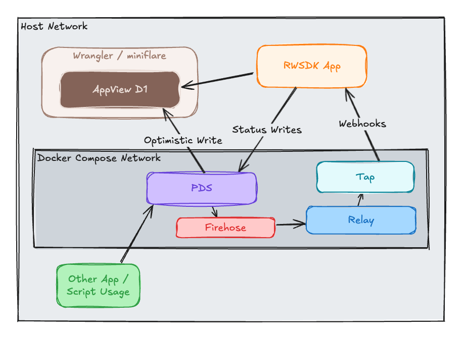

[Post 5](./rwsdk-atproto-05-tap-sync) introduced two complementary patterns for reads in AT Protocol apps: an optimistic update for your own writes (fast, no relay delay), and the relay/firehose path for everyone else's writes (the full picture, including external apps). Post 5 then built the relay side. This post adds the optimistic update to the D1 database [Post 6](./rwsdk-atproto-06-d1-persistence) added and opens the status board to unauthenticated visitors making it a more real-world useful [AppView](https://atproto.com/guides/the-at-stack#app-views).

## Optimistic update for your own writes

When you write a record to the PDS and it succeeds, you don't need to read it right back because clearly you already have the data for it. The relay will deliver it back eventually, but there's no reason to wait. The approach for a better user experience is to write into D1 immediately after the PDS confirms success:

```typescript
const res = await lexClient.put(
  statusSchema,
  { status: emoji, createdAt: new Date().toISOString() as DatetimeString },
  { rkey: "self" }
);

// We already have the data so we don't need to wait for the relay
await db
  .insert(statuses)
  .values({ did, handle, status: emoji, updatedAt: new Date().toISOString() })
  .onConflictDoUpdate({
    target: statuses.did,
    set: { status: emoji, updatedAt: new Date().toISOString() },
  });

const allStatuses = await db.select().from(statuses);
pushToSseClients(allStatuses);
```

The Tap webhook will still arrive for this write since the relay doesn't know you already indexed it. That's fine: the upsert is idempotent, so the second write is a no-op. Both paths converge to the same D1 row.

The benefit is immediate: pick a status and the feed updates without waiting for the relay. The relay path kicks in for other users' writes and for any external app writing `xyz.statusphere.status` records that never touched your UI.

One honest note on local dev behavior: in a deployed Cloudflare Workers environment the SSE push delivers directly to connected browsers. Locally, the Vite dev proxy appears to buffer Worker streaming responses rather than forwarding them flush-on-write, so updates arrive when the browser's `EventSource` reconnects instead of via direct push. The SSE endpoint sets `retry: 100` to keep that reconnect fast enough to be imperceptible in practice. Deployed behavior — direct push, no reconnect — is the intended pattern and will be confirmed in a future update once this has run against a live environment.

## Opening the status board

The `StatusFeed` component was rendered inside `{did ? ... : ...}` so it was only visible when signed in. Moving it outside that conditional makes the board public:

```tsx
// before: board only visible when logged in
{did ? (
  <>
    <StatusPicker ... />
    <StatusFeed initialStatuses={...} />
  </>
) : (
  <LoginForm />
)}

// after: board always visible
{did ? (
  <StatusPicker ... />
) : (
  <LoginForm />
)}

<section>
  <StatusFeed initialStatuses={await db.select().from(statuses)} />
</section>
```

The D1 query hasn't changed. There's no WHERE clause in the previous versions so it always returned all rows. The only thing that changed is who can see them.

## The demo

1. Normal window: sign in as `alice.devnet.test` / `alice-devnet-pass`, set a status and notice the feed updates instantly
2. Incognito window: sign in as `bob.devnet.test` / `bob-devnet-pass`, set a different status and both Bob's and Alice's windows update instantly
3. In a terminal: run `pnpm write-status` to write Carol's status directly to the PDS, bypassing the local app entirely. Alice's and Bob's windows update after a brief delay as the events flow through the relay, tap, and webhook processes. **Note:** this script also ensures that Carol has been authenticated to her PDS and then adds her PDS to the Tap's repositories to send out via webhook.  Without that second part the Tap webhooks would not include Carol's status updates.
4. Open any window without logging in and the status board shows all three

Steps 1 and 2 both take the optimistic path: the app writes to D1 immediately after the PDS confirms, then SSE notifies all connected windows. Step 3 is the relay path: the write goes straight to Carol's PDS without touching the local app, Tap picks it up from the firehose, delivers the webhook, and only then does D1 update and SSE fire. Step 4 confirms the public board is populated purely from D1, no auth required.

In local dev, steps 2 and 3 will feel roughly the same speed — the local Docker network is fast enough that relay overhead is negligible, and the SSE retry workaround (described above) puts a floor on how fast either path can update the UI anyway. The meaningful difference between the two paths — optimistic is immediate, relay adds network latency — will be observable in a deployed environment where the relay runs on real infrastructure.

## Status board, not feed

The D1 schema stores one row per DID, updated in place. This isn't a feed in the chronological sense since it's a snapshot of the latest status per user. "Feed" implies a stream of events; what this renders is a leaderboard of current states. If you wanted a true feed you'd append rows instead of upsert and query by recency. The upsert model is right for this use case where you care about who has what status now, not the history.

## You're an AppView

This is the pattern AT Protocol calls an AppView:

1. Subscribe to the firehose (Tap handles this, subscribing to the PDS relay)
2. Filter for the record types you care about (`xyz.statusphere.status`)
3. Index them into your own database (D1, upserted by DID)
4. Serve your own query interface (the public status board)

Bluesky's AppView does exactly this: subscribes to the global Relay, indexes posts, likes, follows, and profiles from every PDS on the network, and serves them through its own API. The only substantial difference is scale (admittedly it's an incredibly large difference in scale).

The full data path, with both read patterns in place.




```
User picks status in your app
  → PDS confirms the write
  → Optimistic update: Worker writes to D1 immediately
  → SSE pushes updated board to all connected browsers

Meanwhile on the relay side:
  → PDS emits firehose event
  → Tap delivers POST /webhooks/tap
  → Worker upserts into D1 (idempotent; same row, same data)
  → SSE push (no visible change, already up to date)

Other user or external app writes a status
  → Relay path only (optimistic path isn't available since it is not your write)
  → Tap delivers POST /webhooks/tap
  → Worker upserts into D1
  → SSE pushes updated board
```

You built each step in this chain one post at a time. This is where the full picture connects.

## What's next

We've pretty much built an AppView at this point!  The entirety of [the final post](./rwsdk-atproto-08-next-steps) is where to go from here including production considerations, further reading, and other thoughts.  Aside from those topics you probably have a lot of your own features to build and add to this app now so go crazy!

Let me know what you're doing with this, feedback you have, or anything you want to talk about over on [Bluesky](https://bsky.app/profile/arsdehnel.com) or [GitHub](https://github.com/arsdehnel)!